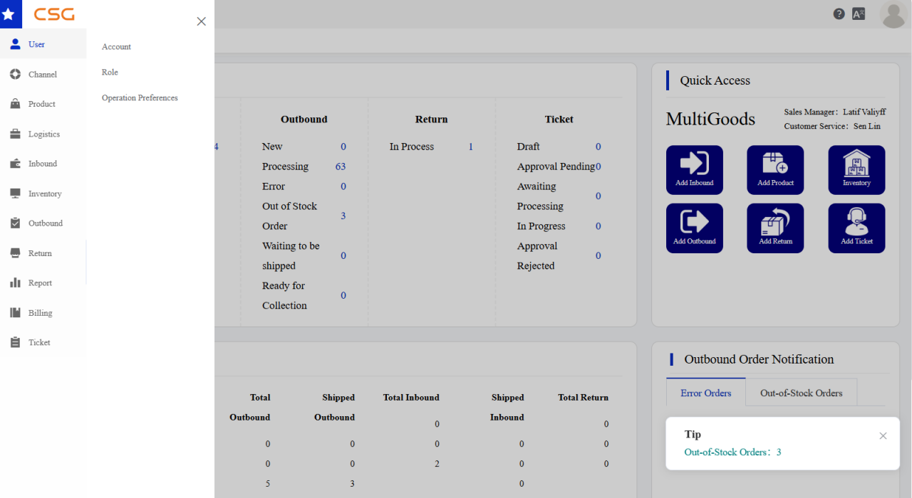

# CSG_ERP_User_Module

# CSG ERP User Management

*Administration of company users, roles, and operation preferences in the CSG Customer Portal.*

The **User Management** module is the administrative area of the **CSG Customer Portal** used to maintain company login accounts, role-based access, and customer-specific operational settings. It is intended for customer administrators and other authorized users.

The module consists of **User Account**, **Role**, and **Operation Preferences**. Customer administrators first issue portal accounts to users within their company and then assign one or more roles to each account. The assigned roles determine which menus, information, and functions the user can see and operate. Operation Preferences define the company’s preferred service and workflow settings. At least one role must exist before a user account can be created.

| **CSG ERP User Management** |  |
| --- | --- |
| **Portal** | CSG Customer Portal |
| **Menu** | User |
| **Audience** | Customer administrators and authorized users |
| **Purpose** |  Issue and maintain company user accounts, control visible functions through roles, and configure service preferences | |
| **Components** | User Account; Role; Operation Preferences |
| **Key dependency** | Every new account requires at least one existing role |
| **Source** | CSG ERP User Manual, section 5 |
- **Contents**
    
    

## Access and scope

The **User** menu appears in the portal’s left navigation. Its submenu provides access to **Account**, **Role**, and **Operation Preferences**.

*Figure 1. User module navigation in the CSG Customer Portal.*

User Management is distinct from **Account Center**. Account Center is a self-service area for the currently signed-in user to maintain personal information. User Management is an administrative area for maintaining all accounts belonging to the customer company.

Before creating an account, an administrator should confirm that:

- At least one role exists under **User → Role**.
- The administrator is authorized to manage accounts and roles.
- The required role or roles have been identified for the new user.

**Important:** A user account cannot be created without a role assignment.

## User Account

*Path: **User → Account***

The **User Account** area creates and maintains customer-company login accounts. Authorized administrators can create and view accounts, edit user information, assign or remove roles, enable or disable accounts, lock or unlock access, reset passwords, and delete accounts.

### Account List

The Account List displays all user accounts created under the customer company. Search controls appear above the account records, while account-specific actions appear in the **Action** column.

*Figure 2. Account List with search controls and company user accounts.*

**Page functions**

| Function | Description |
| --- | --- |
| Search | Finds user accounts matching the selected criteria. |
| Add Account | Opens the form for creating a user account. |
| Edit | Opens the selected account for modification. |
| Operate | Opens additional account-management actions. |

**Account columns**

| Column | Meaning |
| --- | --- |
| Account | Login account used to access the portal. |
| Name | User display name. |
| Status | Account status: **Enable** or **Disable**. |
| Lock | Account lock state. |
| Created By | User who created the account. |
| Date Created | Account creation date and time. |
| Valid From | Date on which the account becomes effective. |
| Action | Opens account editing or management operations. |

### Creating or editing an account

The Add/Edit Account page stores the user’s login details, contact information, validity period, and assigned roles.

*Figure 3. Add/Edit Account page with account information and role assignment.*

| Field | Description |
| --- | --- |
| Account | Unique login account used to access the system. |
| Name | User display name. |
| Phone | Contact phone number. |
| Email | User email address; optional. |
| Valid From | Date on which the account becomes active. |
| Valid Until | Account expiration date; optional. |

The create-account form also displays a **Password** field. Fields marked as required in the portal must be completed before the account can be saved.

### Role assignment

An account can receive one or more predefined roles. The assigned roles determine which menus and functions the user can access after signing in.

To create or update an account:

1. Navigate to **User → Account**.
2. Select **Add Account**, or select **Edit** for an existing account.
3. Enter or update the user’s account information.
4. Select **Add Role** and choose one or more roles.
5. Select **Confirm** to save the account.

### Account operations

The **Operate** menu provides account-state and security actions. The options displayed may depend on the account’s current state.

*Figure 4. Account operations available from the Account List.*

| Operation | Effect |
| --- | --- |
| Change Password | Resets or updates the user’s login password. |
| Disable | Disables the account and prevents login. |
| Enable | Re-enables a disabled account. |
| Lock | Locks the account to prevent access. |
| Unlock | Unlocks a locked account. |
| Delete | Permanently removes the account. |

**Caution:** Deletion is permanent. Verify the selected account before completing the action.

## Role

*Path: **User → Role***

The **Role** area defines access for users belonging to the customer company. A role can be assigned to one or more users and can contain menu permissions that determine which portal functions those users can access.

### Role List

The Role List displays the roles created by the customer company. Authorized users can search roles by name, status, or description; add and edit roles; disable roles; assign users; assign menu permissions; and view operation logs.

*Figure 5. Role List and role-specific actions.*

### Role actions

| Action | Description |
| --- | --- |
| Disable | Disables the selected role. |
| Assign User | Assigns company users to the role. |
| Assign Menu Permissions | Sets the portal menus and functions available to the role. |
| Log | Displays operation records for the role. |

## Operation Preferences

*Path: **User → Operation Preferences***

**Operation Preferences** stores customer-specific settings for selected inbound, outbound, and return processes. Authorized users can inspect the current configuration in **View** mode and modify it in **Edit** mode. Settings cannot be changed while the page is in View mode.

### Preferences List

The Preferences List displays the operation-preference record for the customer company.

*Figure 6. Operation Preferences List.*

| Column | Meaning |
| --- | --- |
| Customer Name | Customer account name. |
| Company Name | Registered company name. |
| Date Created | Date and time when the preference record was created. |
| Modification Time | Date and time of the most recent update. |
| Action | Opens the record in View or Edit mode. |

### Preferences Detail

Selecting **View** or **Edit** opens the Operation Preferences detail page. The available settings may include return-function settings, inbound email notifications, outbound proof-of-delivery settings, photo-provision requirements, and product-handling rules.

*Figure 7. Operation Preferences detail page.*

In Edit mode, update the required settings and select **Save** to apply the changes.

## Access-control model

The User module follows a role-based access relationship:

| Object | Managed through | Controls or affects |
| --- | --- | --- |
| Role | **User → Role** | Menu and function permissions. |
| User account | **User → Account** | Login identity, validity, account state, and assigned roles. |
| Menu permissions | **Assign Menu Permissions** on a role | Portal areas available to users assigned to that role. |
| Operation Preferences | **User → Operation Preferences** | Selected inbound, outbound, and return behaviours for the customer company. |

The principal dependencies are:

- A role must exist before an account is created.
- Every new account requires at least one assigned role.
- Assigned roles determine the user’s available menus and functions.
- Disabled or locked accounts cannot access the portal.
- Operation Preferences can be changed only by authorized users in Edit mode.