# CSG ERP Customer Portal User Manual

This manual explains how customer users access and operate the CSG Customer Portal. It covers portal access, dashboard navigation, user and channel administration, product and logistics configuration, inbound and outbound operations, inventory, returns, reporting, billing, tickets, and supporting reference information.

The manual is intended for customer administrators and operational users. The functions visible to each user may vary according to the user's assigned role, company configuration, enabled services, and customer agreement.

| Item | Description |
| --- | --- |
| System   | CSG Customer Portal |
| Audience | Customer administrators and authorized operational users |
| Coverage | Sections 1 through 16 of the CSG ERP User Manual |
| Format | MkDocs-compatible Markdown with local image assets |
| Source | CSG ERP User Manual supplied by the user |

## Contents

1. [1. Introduction](#1-introduction)
2. [2. Login](#2-login)
3. [3. Dashboard](#3-dashboard)
4. [4. Account Center](#4-account-center)
5. [5. User Management](#5-user-management)
6. [6. Channel Management](#6-channel-management)
7. [7. Product](#7-product)
8. [8. Logistics](#8-logistics)
9. [9. Inbound](#9-inbound)
10. [10. Inventory](#10-inventory)
11. [11. Outbound](#11-outbound)
12. [12. Returns Management](#12-returns-management)
13. [13. Report](#13-report)
14. [14. Billing & Invoice](#14-billing-invoice)
15. [15. Ticket](#15-ticket)
16. [16. Appendix](#16-appendix)

## 1. Introduction

This section introduces the CSG Customer Portal, its intended users, supported access environment, and the scope of the customer user manual.

### 1.1 Purpose

This document provides step-by-step instructions for customers using the CSG Customer Portal.

The manual explains how to access the portal, navigate the dashboard, manage users, manage products, create inbound and outbound orders, check inventory, view return orders, and download reports.

It is designed to help customers complete daily 3PL operations accurately and efficiently through the CSG system.

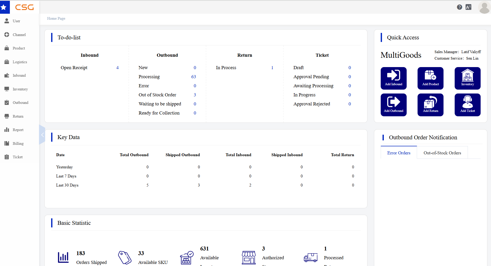

*Figure 1. Purpose screen from the CSG ERP User Manual.*

### 1.2 Target Users

This manual is intended for CSG customers who use the portal to manage their 3PL operations.

Typical users include:

Online store owners

E-commerce operation staff

Customer service staff

Inventory or stock management staff

Order fulfilment coordinators

Company administrators who manage user accounts and access permissions

### 1.3 System Requirements

| Item | Requirement |
| --- | --- |
| Browser | Any modern web browser |
| Internet | Stable internet connection |
| Device | Desktop, laptop, tablet or mobile device |

## 2. Login

This section explains how an authorized customer user signs in to the CSG Customer Portal and begins a portal session.

### 2.1 Access System

Users can access the CSG Customer Portal through the following URL:

https://3pl.wooper.com

The portal can be opened using a desktop browser, laptop browser, tablet browser, or mobile phone browser.

### 2.2 Login Steps

Step 1: Open the CSG Customer Portal login page.

Step 2: Enter your registered username and password.

Step 3: Click the Login button to access the portal.

Step 4: After successful login, the system will redirect you to the Dashboard page.

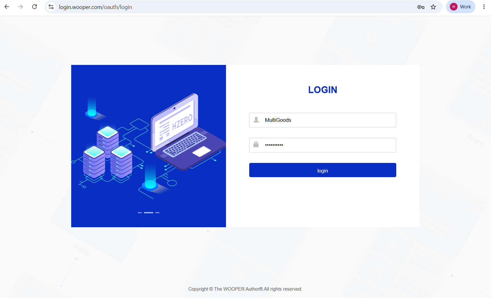

*Figure 1. Login Steps screen from the CSG ERP User Manual.*

### 2.3 Notes

The username and password will be provided by CSG or your company administrator.

Passwords are case-sensitive.

Please ensure the username and password are entered correctly.

If you forget your password or cannot log in, please contact CSG support.

## 3. Dashboard

This section explains the Customer Portal dashboard, including navigation, pending work, shortcuts, operational notifications, and summary information.

### 3.1 Overview

After logging into the CSG Customer Portal, users will be redirected to the Dashboard page.

The dashboard provides an overview of daily 3PL operations, including inbound receipts, outbound orders, return orders, inventory information and order notifications.

Users can also quickly access commonly used functions through the Quick Access section.

*Figure 1. Overview screen from the CSG ERP User Manual.*

### 3.2 Main Functions

| Function | Description |
| --- | --- |
| Navigation Menu | Allows users to access different modules, such as User, Channel, Product, Inbound, Inventory, Outbound, Return, Report, Billing and Ticket |
| To-do-list | Displays pending inbound, outbound, return and ticket tasks |
| Quick Access | Provides shortcut buttons for common actions, such as Add Inbound, Add Product, Inventory, Add Outbound, Add Return and Add Ticket |
| Key Data | Shows recent inbound, outbound and return statistics |
| Outbound Order Notification | Displays error orders and out-of-stock orders |
| Basic Statistic | Shows key figures such as shipped orders, available SKUs and processed orders |
| User Profile | Allows users to access account-related settings |

## 4. Account Center

This section explains the signed-in user's account profile and account-level settings, including password maintenance and profile information.

### 4.1 Overview

The Account Center allows users to manage their own account information and personal settings. From this module, users can update their profile information, change their profile picture, reset their password, and view API information when permitted by their assigned role.

### 4.2 Access Account Center

Navigation

Click the User Avatar in the upper-right corner of the Customer Portal, then select Account Center.

The Account Center provides quick access to personal account management functions.

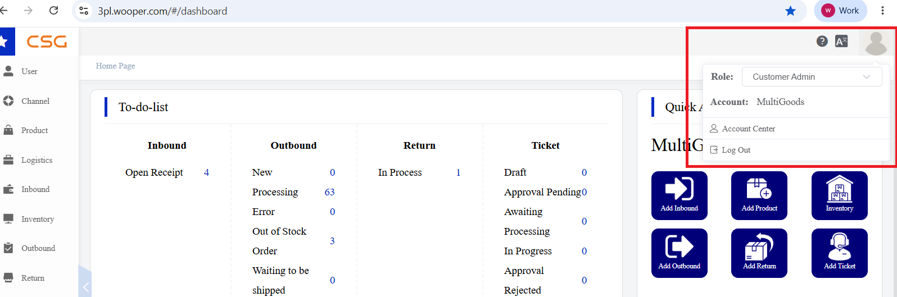

*Figure 1. Access Account Center screen from the CSG ERP User Manual.*

### 4.3 Personal Information

The Account Center displays the user’s personal account information.

| Item | Description |
| --- | --- |
| Login Account | The username used to log in to the portal |
| Name | The user or company display name |
| Belongs to Tenant | The tenant that the account belongs to |
| Change Password | Allows the user to update the login password |
| Valid From | The account activation date |
| API Key | The API key assigned to the account |
| Profile Picture | The user profile image |

### 4.4 Change Profile Picture

Users can update their profile picture in the Account Center.

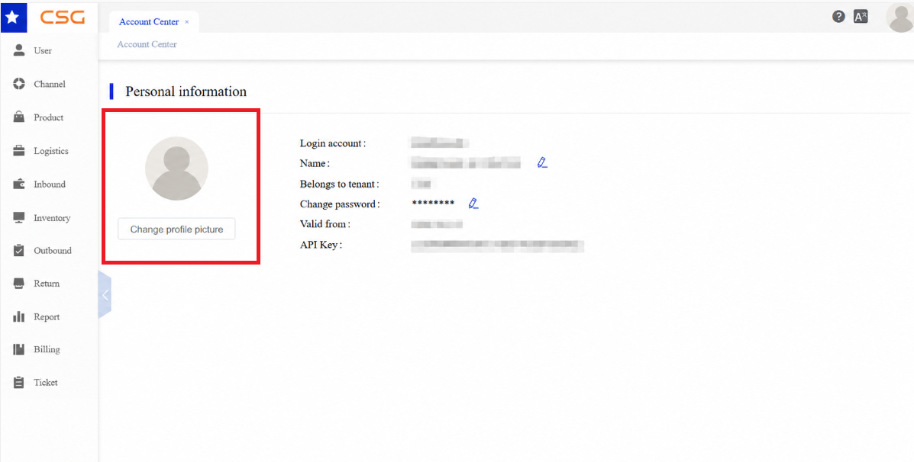

*Figure 2. Change Profile Picture screen from the CSG ERP User Manual.*

**Steps**

Step 1: Open the Account Center page.

Step 2: Click Change Profile Picture.

Step 3: Select an image from the local device.

Step 4: Save the changes.

### 4.5 Change Password

Users can update their login password through the Account Center.

**Steps**

Step 1: Open the Account Center page.

Step 2: Click the edit icon next to Change Password.

Step 3: Enter the following information:

Old password

New password

Confirm new password

Step 4: Click Confirm to save the changes.

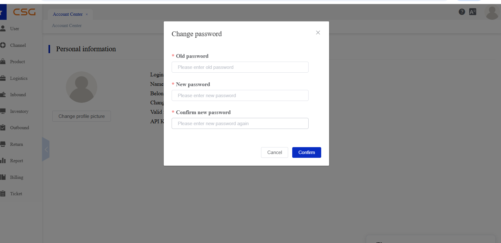

*Figure 3. Change Password screen from the CSG ERP User Manual.*

### 4.6 API Key

The API Key area is visible only to users whose assigned roles include the relevant permission.

The system supports two API connection methods depending on your account configuration.

Option 1 – Existing API Key

If an API Key has already been configured, it will be displayed on this page and can be used directly for system integration.

*Figure 4. API Key screen from the CSG ERP User Manual.*

Option 2 – New API Connection

If no API Key is available, click Add New API Connection to generate a new API Key for external system integration.

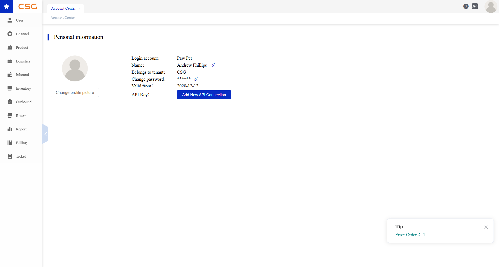

*Figure 5. API Key screen from the CSG ERP User Manual.*

**Note:** API functionality is optional and is intended for customers who need to integrate the ERP system with third-party applications.

## 5. User Management

User Management controls who can use the Customer Portal and what each user can access. Only an administrator can create and maintain accounts for users within the customer’s company. Separate accounts may be provided to finance, cashiering, supplier-management, and other operational staff, with access determined by their assigned roles. Operation Preferences controls selected operational behaviours, including notification and photographic-record options.

The User Management module provides tools for managing user accounts, access permissions, and customer-specific operational settings.

The module consists of three sections:

User Account – Create and manage user accounts within the company, including role assignment and account status.

Role – Define user roles and configure menu permissions.

Operation Preferences – Configure operational rules and preferences for warehouse processes.

**Note:** Before creating a user account, at least one role must exist in the system. User accounts cannot be created without assigning a role.

### 5.1 User Account

#### 5.1.1 Overview

The User Account module is used to create and manage user login accounts within the CSG Customer Portal. Administrators can create new accounts, maintain user information, assign roles, and control user access to the system.

Unlike the Account Center, which is used to manage the currently logged-in user's personal information, the User Account module is designed for administrators to manage all user accounts within the company.

Users can:

Create new user accounts

View existing accounts

Edit user information

Assign or remove roles

Enable or disable accounts

Lock or unlock accounts

Reset user passwords

Delete user accounts

*Figure 1. Overview screen from the CSG ERP User Manual.*

#### 5.1.2 Account List

The Account List displays all users created under the customer company.

Navigation

Main Functions

| Function | Description |
| --- | --- |
| Search | Search user accounts. |
| Add Account | Create a new user account. |
| Edit | Modify account information. |
| Operate | Perform account management actions. |

Account Information

| Column | Description |
| --- | --- |
| Account | Login account. |
| Name | Username. |
| Status | Account status (Enable / Disable). |
| Lock | Account lock status. |
| Created By | User who created the account. |
| Date Created | Account creation date. |
| Valid From | Account effective date. |
| Action | Edit or manage the account. |

*Figure 2. Account List screen from the CSG ERP User Manual.*

#### 5.1.3 Add/Edit New User

The Add/Edit Account page is used to maintain user information and assign roles to a user account. The administrator sets the login account. The system generates the initial password, which the administrator can subsequently change or reset.

Account Information

| Field | Description |
| --- | --- |
| Account | Unique login account used to access the system. |
| Name | User's display name. |
| Phone | Contact phone number. |
| Email | User's email address (optional). |
| Valid From | Date the account becomes active. |
| Valid Until | Account expiration date (optional). |

*Figure 3. Add/Edit New User screen from the CSG ERP User Manual.*

Role Assignment

One or more predefined roles can be assigned to the user account. Each role must first be created separately, and its permissions can be configured independently.

Roles may be assigned individually or combined for the same user. The assigned roles determine which permitted menus and functions the user can access after logging in.

**Steps**

Step 1: Open User → Account.

Step 2: Click Add Account or Edit.

Step 3: Enter the user's account information.

Step 4: Click Add Role and select one or more roles.

Step 5: Click Confirm to save.

#### 5.1.4 Account Operations

The Operate menu provides additional account management functions.

*Figure 4. Account Operations screen from the CSG ERP User Manual.*

| Operation | Description |
| --- | --- |
| Change Password | Reset or update the user's login password. |
| Disable | Disable the account and prevent login. |
| Enable | Re-enable a disabled account. |
| Lock | Lock the account to prevent access. |
| Unlock | Unlock the account. |
| Delete | Permanently remove the account. A deleted account cannot be restored. |

### 5.2 Role

#### 5.2.1 Overview

The Role section allows authorized users to create and manage roles for their own company users.

Roles are defined by the customer company and can be used to control what each user can access in the portal. Permissions are configured independently for each role, and separately created roles can be combined when assigning access to a user.

*Figure 5. Overview screen from the CSG ERP User Manual.*

#### 5.2.2 Role List

Navigation

The Role page displays all roles created by the customer company.

Users can:

Search roles by role name, status or description

Add new roles

Edit existing roles

Disable roles

Assign users to roles

Assign menu permissions

View operation logs

#### 5.2.3 Role Actions

| Action | Description |
| --- | --- |
| Disable | Disable the selected role |
| Assign User | Assign company users to the role |
| Assign Menu Permissions | Set portal access permissions for the role |
| Log | View role operation records |

### 5.3 Operation Preferences

#### 5.3.1 Overview

The Operation Preferences section allows authorized users to view and configure operational settings for the customer account.

These settings control how certain inbound, outbound and return processes are handled in the portal.

**Note:** Users can view the current operation preference settings by clicking View. To modify the settings, users must click Edit. Changes cannot be made in View mode.

#### 5.3.2 Operation Preferences List

*Figure 6. Operation Preferences List screen from the CSG ERP User Manual.*

Navigation

The list page displays the operation preference record for the customer company.

The page includes:

| Column | Description |
| --- | --- |
| Customer Name | Customer account name |
| Company Name | Registered company name |
| Date Created | Time when the preference record was created |
| Modification Time | Last updated time |
| Action | View or edit operation preferences |

#### 5.3.3 Operation Preferences Detail

Users can click View or Edit to open the operation preferences detail page.

The settings may include:

Return function settings

Inbound email notification

Outbound POD settings

Photo provision requirements

Product handling rules

Users can update the settings and click Save to apply the changes.

Email notification is provided without an additional service fee. Options that require photographic records or photo retention are chargeable services. Where a charge applies, the portal displays the applicable fee so that an authorized user can review it before enabling the option.

*Figure 7. Operation Preferences Detail screen from the CSG ERP User Manual.*

## 6. Channel Management

Channel Management connects external sales channels and business systems to CSG. It maintains store connections and synchronization settings and allows authorized users to monitor orders received from external platforms.

### 6.1 Overview

The Channel Management module is used to integrate external sales channels with this system. Once a sales channel is connected, customer orders can be synchronized automatically from the external platform to the warehouse management system . The module also supports inventory synchronization and order writeback, allowing customers to monitor the fulfillment status of their online orders.

The Channel Management module includes:

Store – Manage connected sales channels and synchronization settings.

External Platform Orders – View and manage orders synchronized from external platforms.

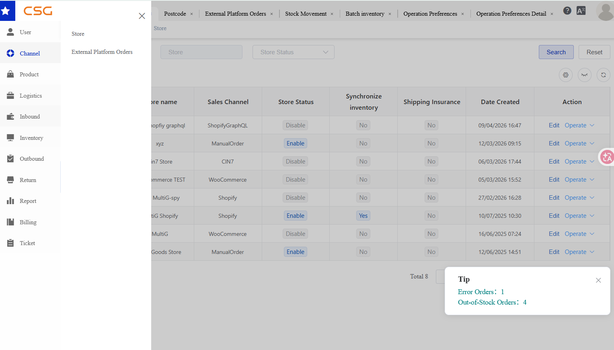

*Figure 1. Overview screen from the CSG ERP User Manual.*

### 6.2 Store

#### 6.2.1 Overview

Navigation

The Store page displays all connected stores under the customer company.

Users can:

Search stores information

Add new stores

Store Actions

#### 6.2.2 Store Information

| Column | Description |
| --- | --- |
| Store Name | Connected store name |
| Sales Channel | Store platform type |
| Store Status | Current store status |
| Synchronize Inventory | Whether inventory synchronization is enabled |
| Shipping Insurance | Shipping insurance setting |
| Date Created | Store creation date |
| Action | Available store operations |

#### 6.2.3 Add Store

The Add Store function allows users to connect an external sales channel or business system to the CSG Customer Portal. The required configuration fields vary depending on the selected Channel Type. After a successful connection, the system can synchronize supported data, such as sales orders, inventory, and shipment information.

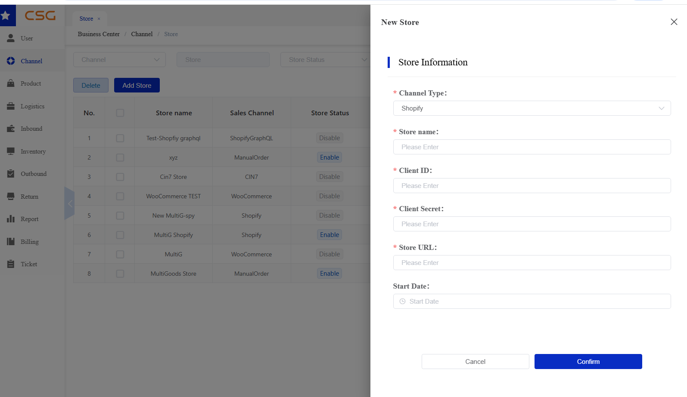

*Figure 2. Add Store screen from the CSG ERP User Manual.*

##### 6.2.3.1 Shopify GraphQL

Description

Shopify GraphQL is the recommended integration method for all new Shopify stores created from April 2026 onwards. It uses Shopify's GraphQL Admin API to synchronize orders, inventory, and shipment information between Shopify and the System.

Use Shopify GraphQL if:

You are connecting to a new Shopify store.

You are creating a new Shopify custom app.

Your app uses the Shopify GraphQL Admin API.

From April 1, 2024, Shopify requires all new public and custom apps to use the GraphQL Admin API. Existing REST integrations continue to work but are considered legacy and should eventually be migrated.

Recommendation: All new Shopify integrations should use Shopify GraphQL.

Required Information

| Field | Required | Description | Where to Obtain |
| --- | --- | --- | --- |
| Channel Type | Must | Select ShopifyGraphQL | Customer Portal |
| Store Name | Must | Display name of the connected store | User-defined |
| Client ID | Must | Shopify App Client ID |  |
| Client Secret | Must | Shopify App Client Secret |  |
| Store URL | Must | Shopify store domain (e.g. yourstore.myshopify.com) |  |
| Start Date | Optional | Date to begin synchronization | User-defined |

Required Information

How to Obtain the Required Information

- Client ID & Client Secret
- Log in to Shopify Admin.
- Navigate to Shopify Admin → Settings → Apps and sales channels.
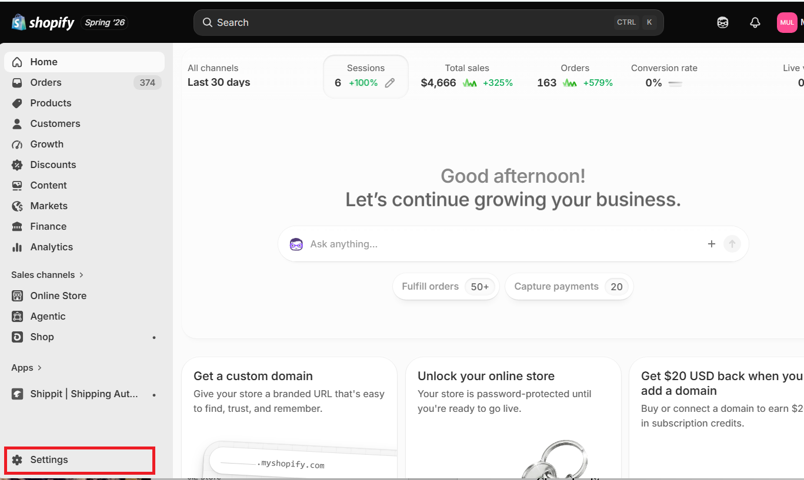

*Figure 3. Shopify GraphQL screen from the CSG ERP User Manual.*

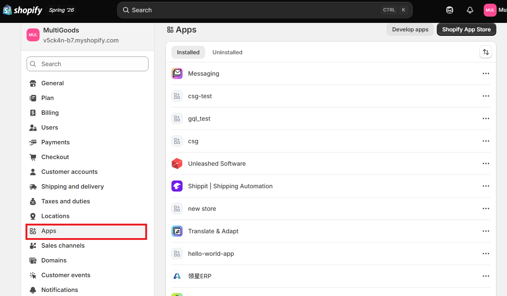

*Figure 4. Shopify GraphQL screen from the CSG ERP User Manual.*

Click Develop Apps.

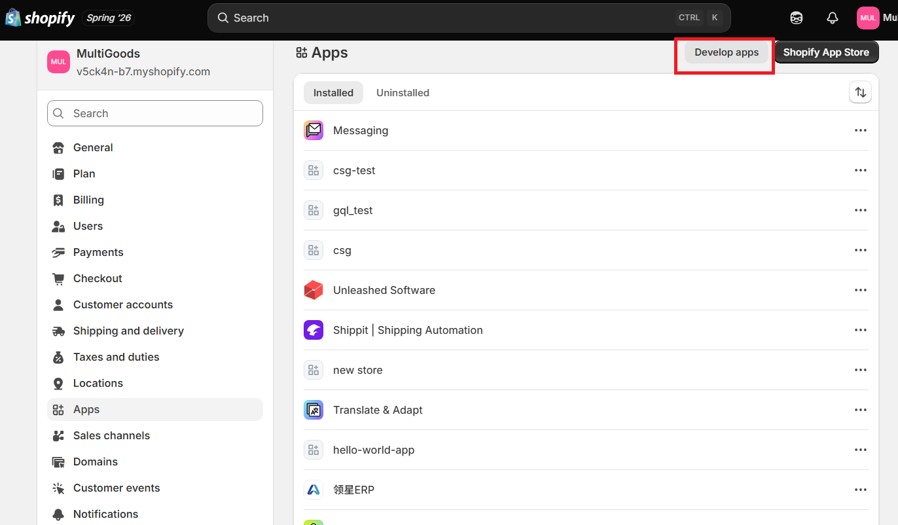

*Figure 5. Shopify GraphQL screen from the CSG ERP User Manual.*

Click Build apps in Dev Dashboard

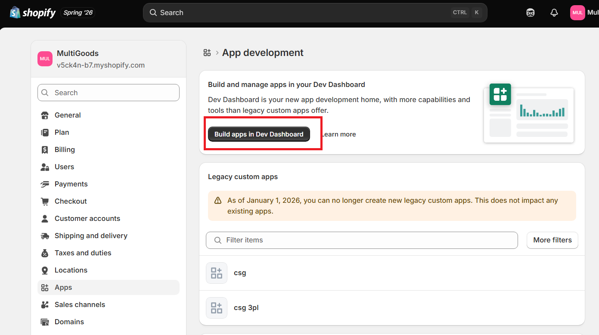

*Figure 6. Shopify GraphQL screen from the CSG ERP User Manual.*

Open the existing integration app (example gql_test).

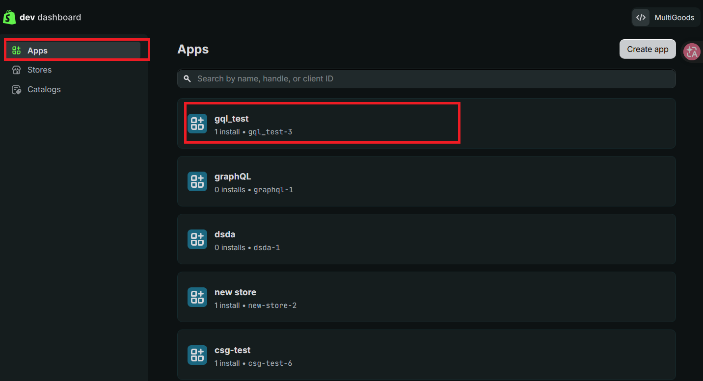

*Figure 7. Shopify GraphQL screen from the CSG ERP User Manual.*

Click Settings.

Under Credentials, copy:

Client ID

Client Secret

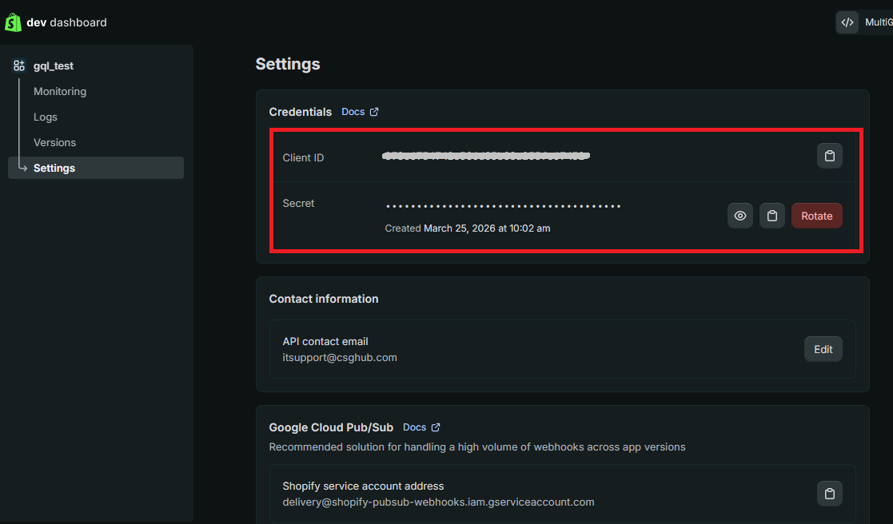

*Figure 8. Shopify GraphQL screen from the CSG ERP User Manual.*

**Note:** If a CSG integration app has not yet been created, it must be created before these credentials are available.

- Store URL
- Return to the Shopify Admin home page and navigate to Settings → Domains.

*Figure 9. Shopify GraphQL screen from the CSG ERP User Manual.*

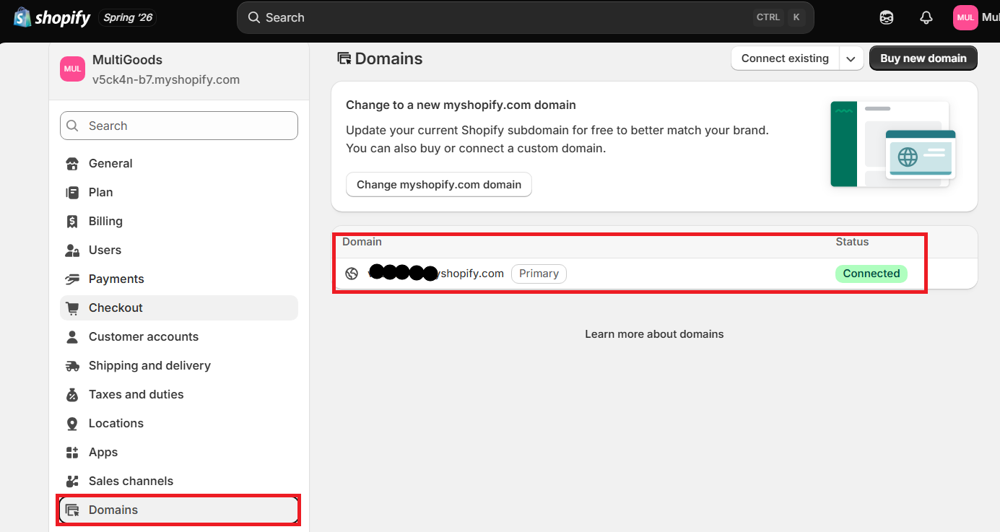

*Figure 10. Shopify GraphQL screen from the CSG ERP User Manual.*

- Locate the primary domain ending with.myshopify.com.
- Copy the domain only.
Example: mycompany.myshopify.com

Add the Store in CSG

- Navigate to:
- Click Add Store and enter:
| Field | Value |
| --- | --- |
| Channel Type | Shopify GraphQL |
| Store Name | Your Store Name |
| Client ID | From Shopify Credentials |
| Client Secret | From Shopify Credentials |
| Store URL | From Shopify Domains |
| Start Date | Optional |
|  |  |

- Click Comfirm.
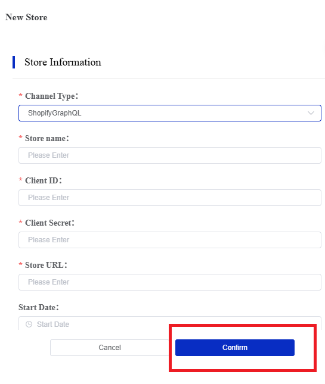

*Figure 11. Shopify GraphQL screen from the CSG ERP User Manual.*

##### 6.2.3.2 Shopify

Description

Shopify uses Shopify's REST API and is provided for existing Shopify integrations created before April 2026. Existing stores may continue using this integration without interruption.

Use Shopify only if:

Your store is already connected using the legacy Shopify REST API.

You are maintaining an existing integration and do not plan to migrate immediately.

Before April 1, 2024, developers could create apps using the REST Admin API.

This option is provided for backward compatibility.

**Note:** This option is maintained for backward compatibility. New Shopify stores should use Shopify GraphQL instead.

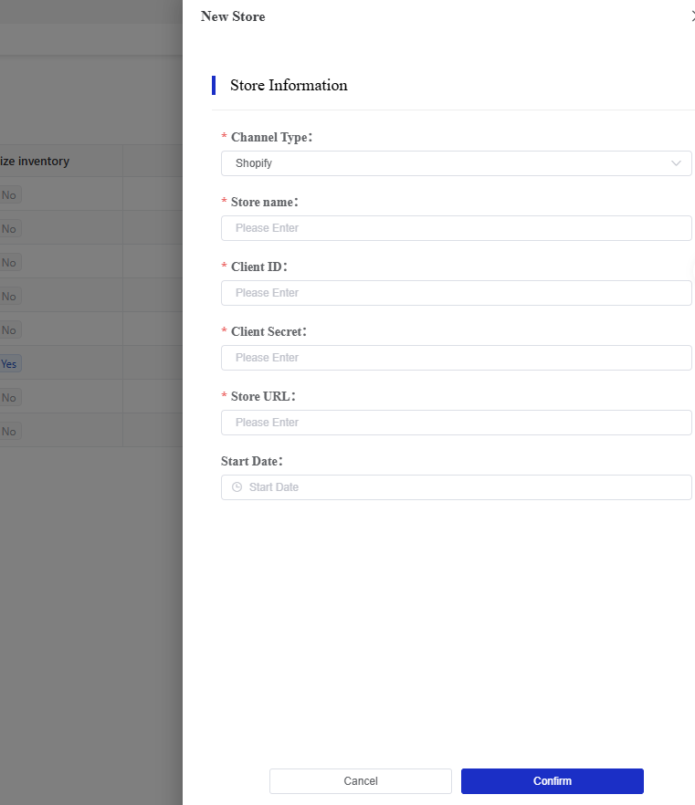

*Figure 12. Shopify screen from the CSG ERP User Manual.*

Required Information

| Field | Required | Required | Description | Where to Obtain |
| --- | --- | --- | --- | --- |
| Channel Type | Must | Select Shopify | Select Shopify | Customer Portal |
| Store Name | Must | Display name of the connected store | Display name of the connected store | User-defined |
| Client ID | Must | Shopify App Client ID | Shopify App Client ID |  |
| Client Secret | Must | Shopify App Client Secret | Shopify App Client Secret |  |
| Store URL | Must | Shopify store domain (e.g. yourstore.myshopify.com) | Shopify store domain (e.g. yourstore.myshopify.com) |  |
| Start Date | Optional | Date to begin synchronization | Date to begin synchronization | User-defined |

##### 6.2.3.3 WooCommerce

Description

WooCommerce connects the Customer Portal to a WooCommerce online store using the WooCommerce REST API.

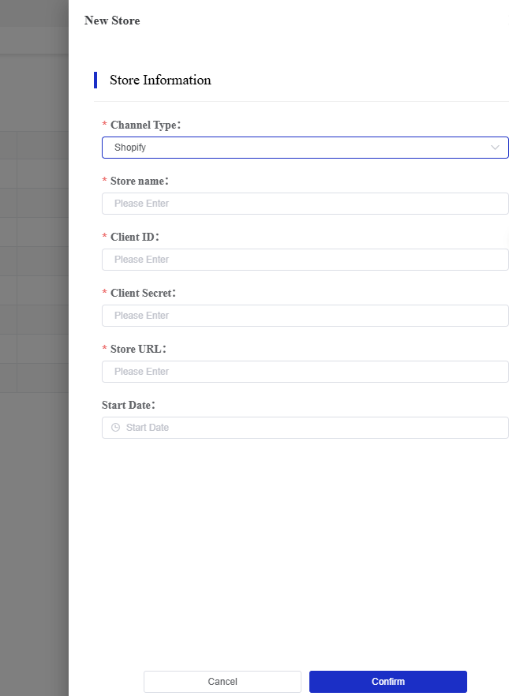

*Figure 13. WooCommerce screen from the CSG ERP User Manual.*

Required Information

| Field | Required | Description | Where to Obtain |
| --- | --- | --- | --- |
| Channel Type | Must | Select WooCommerce | Customer Portal |
| Store Name | Must | Display name of the connected store | User-defined |
| Consumer Key | Must | WooCommerce REST API Consumer Key |  |
| Consumer Secret | Must | WooCommerce REST API Consumer Secret |  |
| Store URL | Must | WooCommerce website URL | WooCommerce Admin |
| Start Date | Optional | Date to begin synchronization | User-defined |

##### 6.2.3.4 Unleashed

Description

Unleashed is a cloud-based inventory and order management system that integrates with the CSG Customer Portal to synchronize sales orders for warehouse fulfillment.

Unlike Shopify and WooCommerce, Unleashed is primarily an inventory and order management platform rather than an e-commerce storefront. Businesses that manage products, inventory, purchasing, and sales orders in Unleashed can connect their account to CSG for automated order synchronization.

Use Unleashed if:

You use Unleashed as your inventory and order management system.

Sales orders are created and managed in Unleashed.

You want sales orders to be synchronized automatically to the CSG Customer Portal.

Your warehouse fulfillment is managed by CSG.

Recommendation: Use Unleashed if it is your primary inventory and order management platform.

Required Information

| Field | Required | Description | Where to Obtain |
| --- | --- | --- | --- |
| Channel Type | Must | Select Unleashed | Customer Portal |
| Store Name | Must | Display name of the connection | User-defined |
| API Key | Must | Unleashed API Key | Unleashed API Access |
| API Password | Must | Unleashed API Password | Unleashed API Access |
| Store URL | Must | Your Unleashed account URL | User-defined |
| Start Date | Optional | Date to begin order synchronization | User-defined |

How to Obtain the Required Information

- API Key
- Log in to Unleashed as the Account Owner.
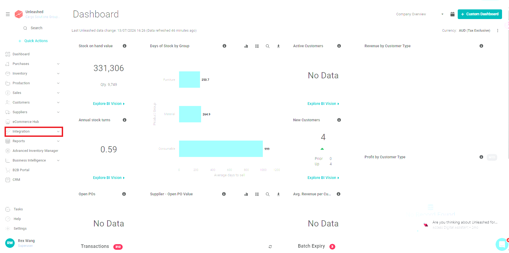

*Figure 14. Unleashed screen from the CSG ERP User Manual.*

- Navigate to Integration → Unleashed API Access.
- Copy: API ID and API Key
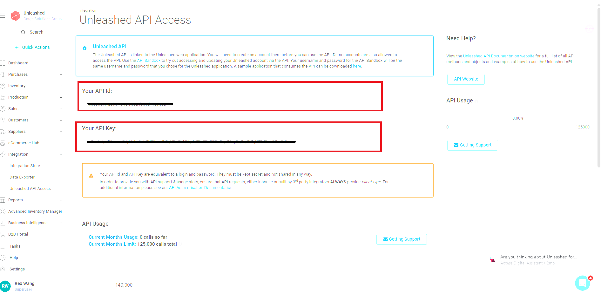

*Figure 15. Unleashed screen from the CSG ERP User Manual.*

**Note:** Only the Account Owner can access the Unleashed API Access page. If the menu is not visible, contact your Unleashed Account Owner or administrator.

- Store URL
The Store URL is the base URL used to access your Unleashed account.

Log in to Unleashed.

Copy the base URL from your browser's address bar.

Enter only the base URL in the Store URL field.

Example

| Correct | Incorrect |
| --- | --- |
| https://go.unleashedsoftware.com | https://go.unleashedsoftware.com/Customers |
| https://go.unleashedsoftware.com | https://go.unleashedsoftware.com/SalesOrders |

Add the Store in CSG

Navigate to:

Click Add Store and enter:

| Field | Value |
| --- | --- |
| Channel Type | Unleashed |
| Store Name | Your Store Name |
| API Key | From Unleashed API Access |
| API Password | From Unleashed API Access |
| Store URL | Your Unleashed account URL |
| Start Date | Optional |

Click Confirm.

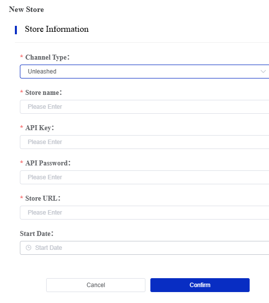

*Figure 16. Unleashed screen from the CSG ERP User Manual.*

#### 6.2.4 Store Actions

Each store record includes an Operate menu.

Available actions may include:

| Action | Description |
| --- | --- |
| Edit | Update the store configuration, including the Store Name and Shipping Warehouse. API connection information is displayed for reference and cannot be modified. |
| Logistics Distribution | Configure the logistics provider and shipping warehouse allocation for the selected store. |
| Enable / Disable | Enable or disable the selected store. When a store is disabled, new orders will no longer be synchronized until the store is enabled again. |
| Delete | Remove the selected store connection from the Customer Portal. Deleting a store does not delete the store from the external sales platform. |
| Log | View the operation history and activity log for the selected store, including configuration changes and synchronization records. |

The available actions may vary depending on the store type and user permissions.

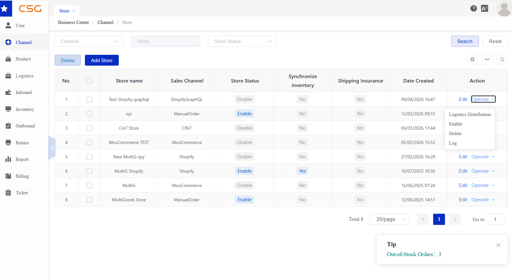

*Figure 17. Store Actions screen from the CSG ERP User Manual.*

##### 6.2.4.1 Edit Store

Navigation

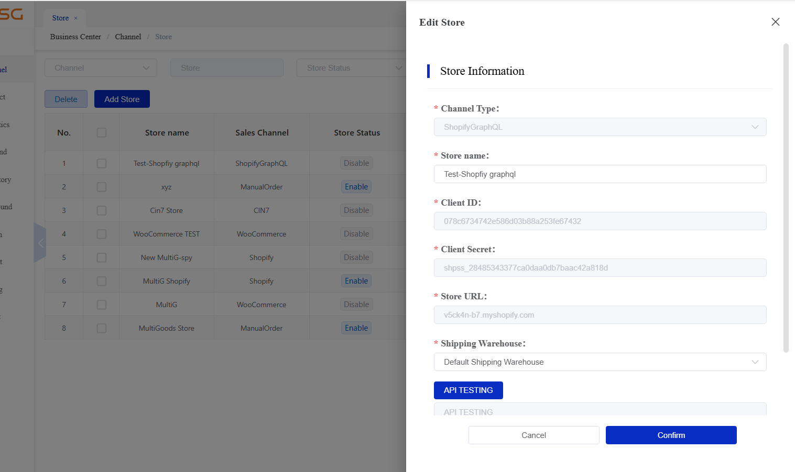

*Figure 18. Edit Store screen from the CSG ERP User Manual.*

Store Information

| Field | Required | Editable | Description |
| --- | --- | --- | --- |
| Channel Type | Must | No | Connected sales channel type. |
| Store Name | Must | Yes | Display name of the connected store. |
| Client ID | Must | No | API Client ID used during store connection. |
| Client Secret | Must | No | API Client Secret used during store connection. |
| Store URL | Must | No | Connected store domain. |
| Shipping Warehouse | Must | Yes | Warehouse that will process orders from this store. |

API Testing

The API Testing button verifies whether the Customer Portal can successfully communicate with the connected sales channel using the configured API credentials.

Possible Results

| Result | Description |
| --- | --- |
| Success | The connection is valid and the store is ready for synchronization. |
| Failed | The connection could not be established. Verify the API credentials, Store URL, or contact the system administrator. |

**Note:** API Testing only verifies the connection. It does not synchronize orders, inventory, or update any data.

*Figure 19. Edit Store screen from the CSG ERP User Manual.*

##### 6.2.4.2 Logistics Distribution

The Logistics Distribution function allows users to configure available courier services for a store.

Users can enable or disable courier services based on operational requirements.

Access Logistics Distribution

**Steps**

Step 1: Open the Store page.

Step 2: Locate the target store record.

Step 3: Click Operate.

Step 4: Select Logistics Distribution.

The system will open the logistics distribution configuration page.

Courier Service Configuration

The page displays available courier services for the selected store.

| Column | Description |
| --- | --- |
| Status | Enable or disable the courier service |
| Courier Service Code | Courier service code |
| Courier Service Name | Courier service provider name |

Users can enable or disable courier services by switching the status button.

Click Save to apply the changes.

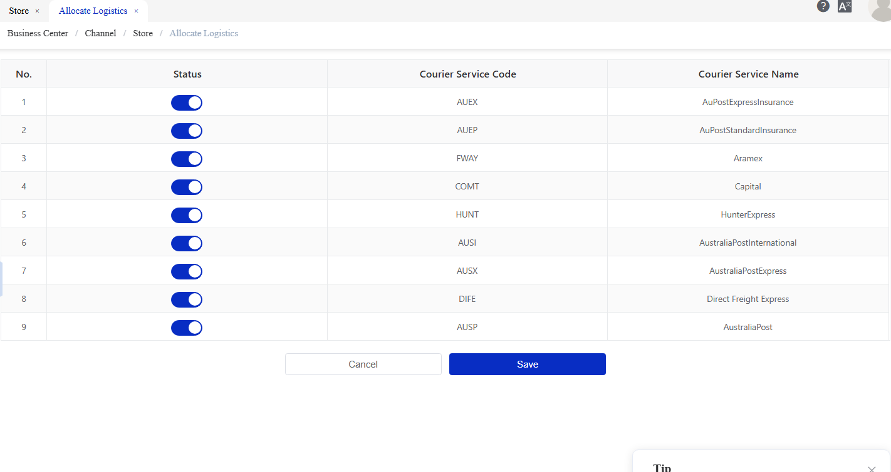

*Figure 20. Logistics Distribution screen from the CSG ERP User Manual.*

##### 6.2.4.3 Operation Log

Users can view operation records for store-related activities.

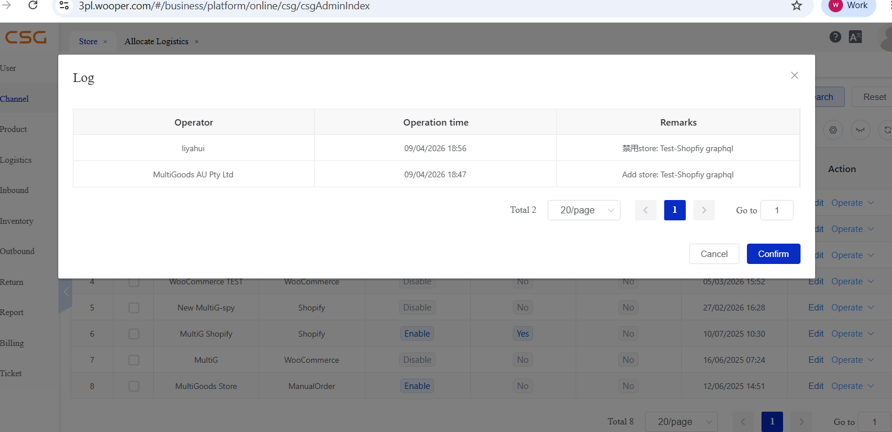

*Figure 21. Operation Log screen from the CSG ERP User Manual.*

### 6.3 External Platform Orders

#### 6.3.1 Overview

After a customer places an order on an external sales channel, the order is synchronized to the Customer Portal.

The system captures all synchronized orders and validates the order information. Orders assigned to the current warehouse are eligible to be transferred to the ERP system for processing.

Depending on the system configuration, eligible orders are transferred to the ERP system automatically or can be manually transferred using the Pull function.

Users can use this module to:

View synchronized orders.

Monitor order processing status.

Search platform orders.

Manually pull eligible orders into the ERP system (when Auto Pull is disabled)

Monitor the order lifecycle from synchronization to shipment.

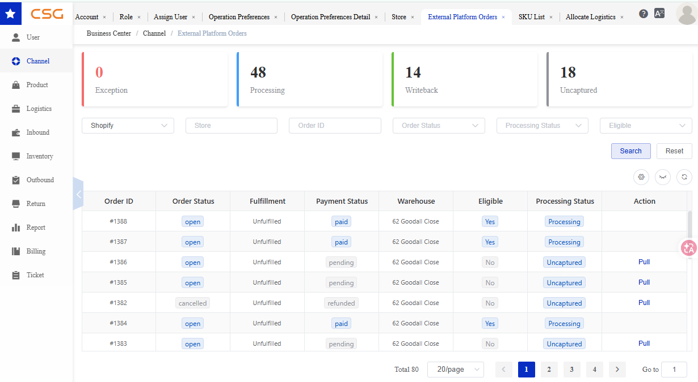

*Figure 22. Overview screen from the CSG ERP User Manual.*

#### 6.3.2 Dashboard Summary

The dashboard provides a quick overview of synchronized order statuses.

| Status | Description |
| --- | --- |
| Exception | Orders that failed validation or encountered processing errors. |
| Processing | Orders that have been transferred to the WMS and are currently being processed by the warehouse. |
| Writeback | Shipment information has been successfully written back to the sales platform. |
| Uncaptured | Orders synchronized but not yet transferred to the WMS. |

**Notes**

Dashboard figures are updated based on the latest synchronization results.

Clicking a status card may display the corresponding order list (if configured).

#### 6.3.3 External Platform Orders List

The External Platform Orders List displays orders synchronized from external sales channels.

Navigation

Available Functions

| Filter | Description |
| --- | --- |
| Platform | View orders from a specific sales channel. |
| Store | View orders from a specific store. |
| Order ID | Search by platform order number. |
| Order Status | Search by platform order status. |
| Processing Status | Search by WMS processing status. |
| Eligible | Filter orders by eligibility status. |

#### 6.3.4 Search Orders

Users can search platform orders using multiple filter conditions.

Search Criteria

| Field | Description |
| --- | --- |
| Platform | Sales channel (e.g., Shopify) |
| Store | Store name |
| Order ID | Platform order number |
| Order Status | Platform order status |
| Processing Status | WMS processing status |
| Eligible | Whether the order can be imported |

**Steps**

Navigate to Channel → External Platform Orders.

Enter one or more search conditions.

Click Search.

Review the search results.

#### 6.3.5 Order Information

Each synchronized order contains the following information:

| Field | Description |
| --- | --- |
| Order ID | External platform order number |
| Order Status | Current platform order status |
| Fulfillment | Fulfillment status on the platform |
| Payment Status | Payment status of the order |
| Warehouse | Assigned fulfillment warehouse |
| Eligible | Whether the order meets import conditions |
| Processing Status | Current WMS processing status |
| Action | Available operation for the order |

Order Status

| Status |  | Description |
| --- | --- | --- |
| Uncaptured |  | The order has been synchronized but has not yet been transferred to the WMS. |
| Processing |  | The order has been transferred to the WMS and is currently being processed. |
| Writeback |  | Shipment information has been successfully written back to the external sales platform. |
| Exception |  | The order cannot be processed due to validation or synchronization errors. |

Payment Status

| Status | Description |
| --- | --- |
| Paid | Payment successfully received |
| Pending | Payment not completed |
| Refunded | Payment refunded |

Processing Status

| Status | Description |
| --- | --- |
| Processing | Order has been imported and is being processed |
| Uncaptured | Order has not yet been imported into WMS |

#### 6.3.6 Pull Orders

The Pull function manually transfers eligible orders assigned to the current warehouse into the Warehouse Management System (WMS).

**Steps**

Locate an order with:

Eligible = Yes

Processing Status = Uncaptured

Click Pull.

The system validates the order information.

The order is transferred to the WMS.

Processing Status changes to Processing.

**Notes**

Only eligible orders can be pulled.

Orders that fail validation cannot be transferred to the WMS.

Successfully transferred orders enter the warehouse fulfillment process.

If Auto Pull is enabled, eligible orders are transferred automatically, and manual Pull is not required.

## 7. Product

The Product module maintains product and SKU master data used by inbound, inventory, outbound, and connected-channel processes.

### 7.1 Overview

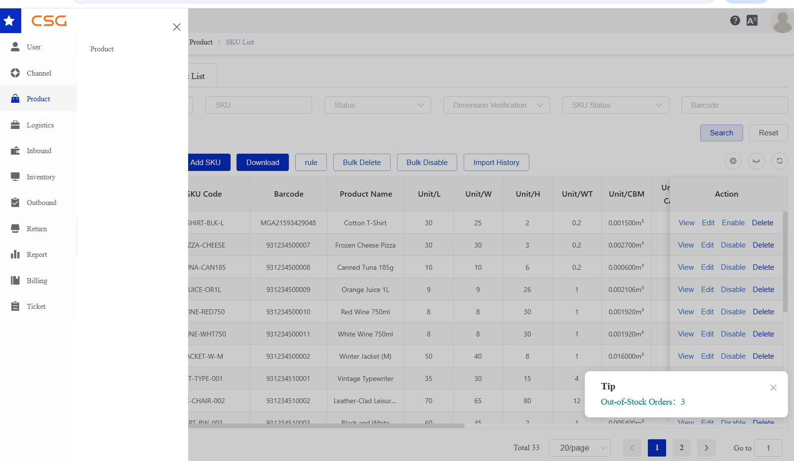

*Figure 1. Overview screen from the CSG ERP User Manual.*

The Product module is used to maintain all products that can be processed by the CSG Customer Portal and the System.

Before orders can be fulfilled, all products sold through connected sales channels should be created and maintained in the Product module. During order synchronization, the system matches the product SKU received from the sales channel with the corresponding SKU configured in the Customer Portal. This ensures that orders can be correctly identified and processed by the warehouse.

The Product module consists of two sections:

SKU List – Used to manage individual inventory products. Each SKU represents a single physical product with its own product information, barcode, dimensions, and weight.

Sales Kit List – Used to manage bundle products composed of multiple individual SKUs. During order fulfillment, the system automatically expands the Sales Kit into its component SKUs for inventory allocation and warehouse picking.

Key Functions

Users can:

Create and maintain product records.

Import and export product information.

Search and update existing products.

Enable, disable, or delete product records.

Create and maintain Sales Kits.

Import Sales Kit information in bulk.

**Notes**

Each SKU Code and barcode must be unique within the system. A barcode corresponds to one SKU.

The SKU configured in the Customer Portal should match the SKU used in connected sales channels (such as Shopify or WooCommerce) to ensure successful order processing.

All component SKUs must exist in the SKU List before they can be added to a Sales Kit.

### 7.2 SKU List

#### 7.2.1 Overview

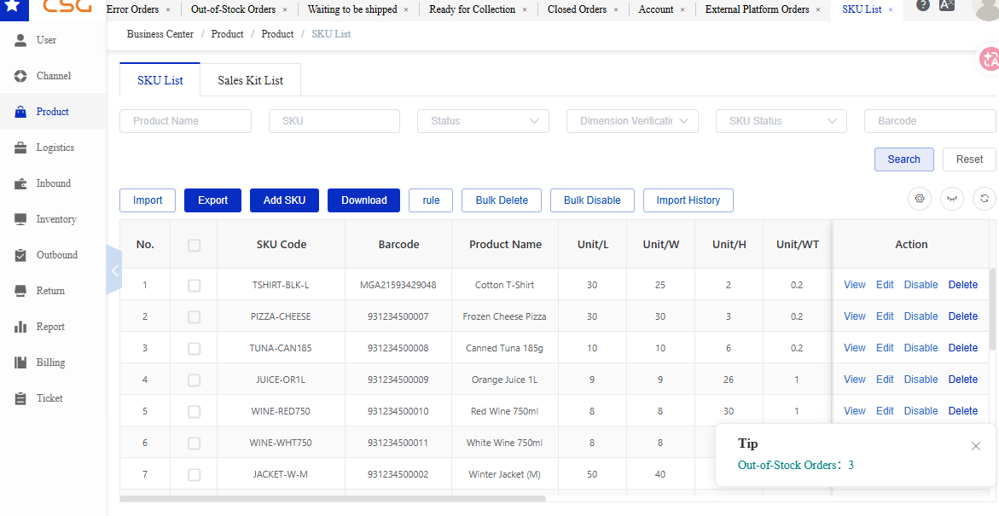

*Figure 2. Overview screen from the CSG ERP User Manual.*

Navigation

The SKU List is used to manage individual products within the Customer Portal. Each product is identified by a unique SKU Code, which serves as the primary product identifier throughout the Customer Portal and Warehouse Management System (WMS).

Each SKU record stores the product information required for inventory management, order processing, warehouse operations, and shipping calculations.

Before orders from connected sales channels can be processed, the corresponding SKU should be created in the SKU List. During order synchronization, the system matches the SKU received from the external sales channel with the SKU maintained in the Customer Portal. Orders containing unmatched SKUs cannot be processed until the SKU information is correctly configured.

Users can:

Search SKU records.

Create new SKUs.

Import SKU information in bulk.

Export SKU data.

View and update SKU information.

Enable or disable SKUs.

Delete SKUs (where permitted)

**Notes**

Each SKU Code must be unique.

The SKU Code should match the SKU used in connected sales channels (such as Shopify or WooCommerce).

Barcode is used during warehouse operations for product scanning and identification.

Product dimensions and weight are used for warehouse handling and shipping calculations.

#### 7.2.2 SKU Information

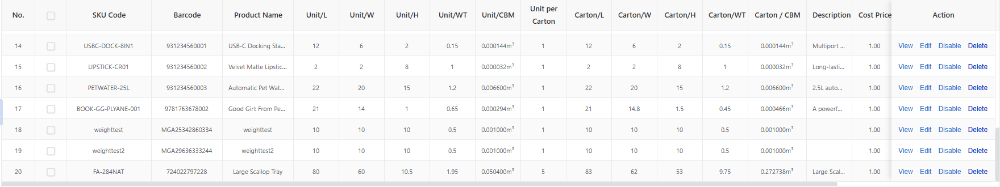

*Figure 3. SKU Information screen from the CSG ERP User Manual.*

Each SKU record contains the following information.

| Field | Description |
| --- | --- |
| No. | Sequence number of the SKU record in the list. |
| SKU Code | Unique product identifier used throughout the Customer Portal and WMS. |
| Barcode | Scannable product code used for product identification during warehouse operations. |
| Product Name | Name of the product associated with the SKU. |
| Unit/L | Length of one individual product unit. |
| Unit/W | Width of one individual product unit. |
| Unit/H | Height of one individual product unit. |
| Unit/WT | Weight of one individual product unit. |
| Unit/CBM | Cubic volume of one individual product unit, displayed in cubic metres. |
| Unit per Carton | Number of individual product units packed in one carton. |
| Carton/L | Length of the shipping carton. |
| Carton/W | Width of the shipping carton. |
| Carton/H | Height of the shipping carton. |
| Carton/WT | Total weight of the shipping carton. |
| Carton/CBM | Cubic volume of the shipping carton, displayed in cubic metres. |
| Description | Additional product description or handling information. |
| Cost Price | Cost price recorded for the product. |
| Status | Current validity status of the product record, such as Effective. |
| Batch and Expiration | Indicates whether batch number and expiration-date management are enabled for the SKU. |
| Dimension Verification | Indicates whether the product dimensions and weight have been checked and verified. |
| SKU Status | Indicates whether the SKU is currently enabled or disabled for system operations. |
| Action | Available actions for the SKU, including View, Edit, Enable/Disable, and Delete. |

#### 7.2.3 Search SKU

Users can search products using multiple filter conditions.

Search Criteria

| Field | Description |
| --- | --- |
| Product Name | Product description |
| SKU | SKU code |
| Status | Product status |
| Dimension Verification | Dimension verification status |
| SKU Status | Current SKU status |
| Barcode | Product barcode |

**Steps**

Navigate to Product → SKU List.

Enter one or more search conditions.

Click Search.

Review the search results.

**Notes**

Multiple search conditions can be combined.

Click Reset to clear all search criteria.

#### 7.2.4 Import SKU

The Import function allows users to create or update multiple SKU records in bulk using the predefined SKU import template.

During the import, the system uses the SKU Code to identify each product:

If the SKU Code already exists in the system, the corresponding SKU record will be updated using the information provided in the import file.

If the SKU Code does not exist, the system will create a new SKU record.

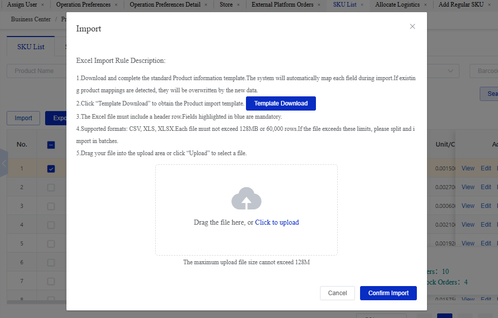

*Figure 4. Import SKU screen from the CSG ERP User Manual.*

**Steps**

Click Download to obtain the import template.

Fill in SKU information according to the template format.

Click Import.

Select the completed file.

Click Upload.

#### 7.2.5 Export SKU

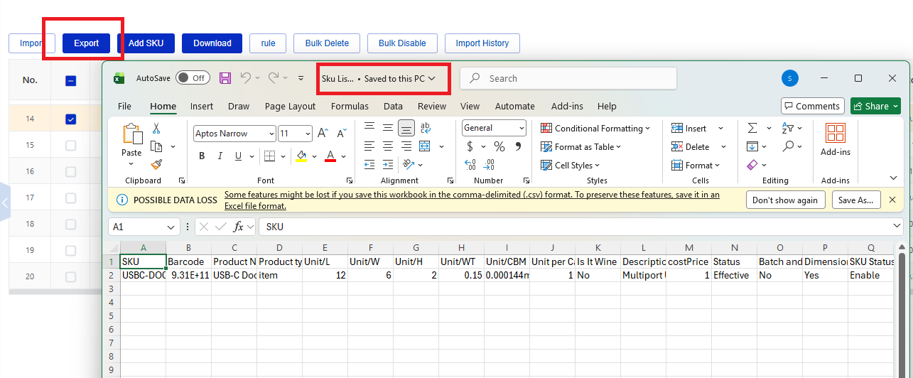

*Figure 5. Export SKU screen from the CSG ERP User Manual.*

Users can export SKU information for reporting or data maintenance.

**Steps**

Apply search filters if required.

Click Export.

Download the generated file.

#### 7.2.6 Add SKU

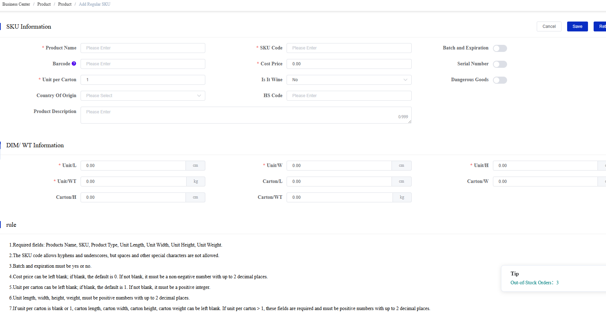

*Figure 6. Add SKU screen from the CSG ERP User Manual.*

Users can manually create a new SKU record.

**Steps**

Navigate to Product → SKU List.

Click Add SKU.

Enter the required product information, including:

Product Name

SKU Code

Barcode

Batch and Expiration (if applicable)

Dimensions

Weight

Click Save.

**Important Product Settings**

- SKU Code
The SKU Code is the unique identifier used throughout the Customer Portal and WMS. It links the product to inventory, inbound receipts, outbound orders, and external sales channels.

**Important:** The SKU Code must be unique and should match the SKU used in connected sales platforms (such as Shopify, WooCommerce, or Unleashed). An incorrect SKU Code may prevent orders from being matched and processed correctly.

- Barcode
The Barcode is used for warehouse scanning during receiving, picking, packing, stocktaking, and other warehouse operations.

Recommendation: Assign one system-unique barcode to each SKU to improve warehouse accuracy and efficiency.

- Batch and Expiration
Enable Batch and Expiration only for products that require batch tracking or expiry date management.

Batch management allows the system to track inventory by production or receiving batch instead of only by SKU. It is commonly used for products that require traceability, quality control, product recalls, or expiry date management, such as food, beverages, pharmaceuticals, cosmetics, and other regulated products.

If Batch and Expiration is enabled:

Warehouse staff must record the Batch Number and Expiration Date during inbound receiving.

Inventory is managed separately for each batch.

The system can support batch traceability, expiry monitoring, and stock allocation by batch.

**Important:**

If your product requires batch tracking or has an expiration date, you should enable Batch and Expiration when creating the SKU. Failure to do so may prevent the system from tracking batches, monitoring expiry dates, and supporting product traceability or recalls.

**Notes**

SKU Code must be unique.

If the product requires batch tracking or has an expiration date, Batch and Expiration should be enabled before the SKU is used.

Accurate dimensions and weight are required for warehouse storage calculations and shipping cost calculations.

Once the SKU has been used in inventory transactions, some settings may be restricted from further modification.

- Dimension
The Dimensions (Length, Width, Height, Weight, and CBM) represent the physical shipping characteristics of the product.

These values are used by the system to:

Calculate warehouse storage space

Calculate storage fees

Estimate shipping and freight costs

Assist with courier service selection

Improve warehouse planning and handling

**Important:** Enter the actual product dimensions and weight. Incorrect dimension data may result in inaccurate storage charges, shipping costs, and warehouse operations.

#### 7.2.7 Download

The Download function is used to generate and download barcode labels for selected SKU records.

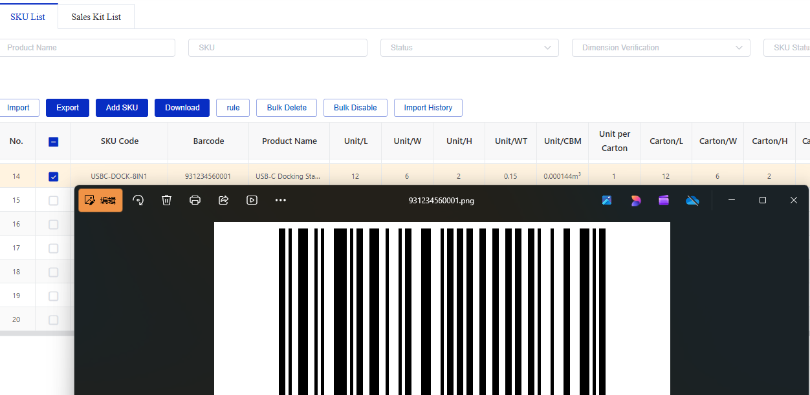

*Figure 7. Download screen from the CSG ERP User Manual.*

**Steps**

Select one or more SKU records.

Click Download.

The system generates barcode labels for the selected products.

**Notes**

The downloaded file contains barcode labels only and is intended for printing.

This function does not export SKU or product master data.

Ensure the selected SKU has a valid barcode before downloading.

Downloaded barcode labels can be printed and attached to products or cartons for warehouse scanning.

#### 7.2.8 Edit SKU

Users can update existing SKU information.

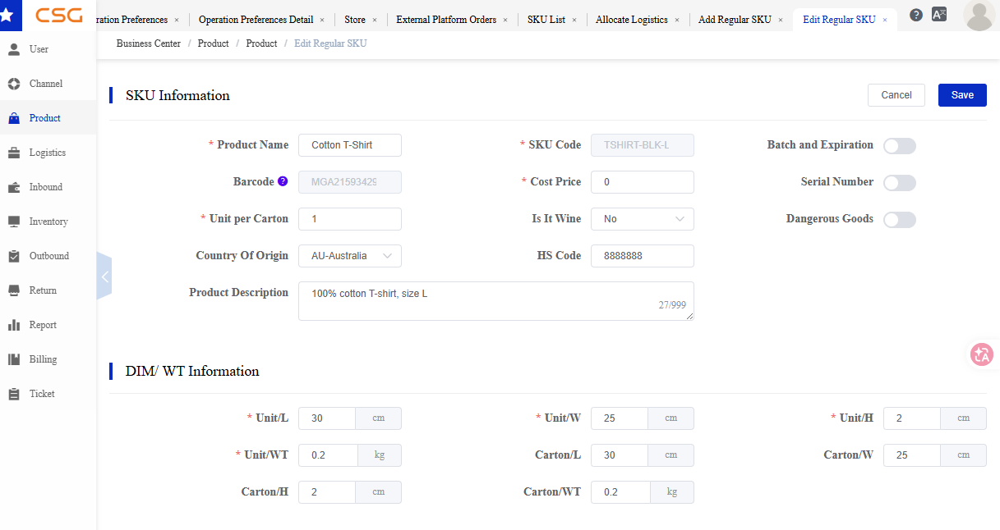

*Figure 8. Edit SKU screen from the CSG ERP User Manual.*

**Steps**

Locate the SKU in the SKU List.

Click Edit.

Modify the required fields.

Click Save.

#### 7.2.9 Disable SKU

The Disabled function marks a SKU as inactive without removing its existing records or transaction history.

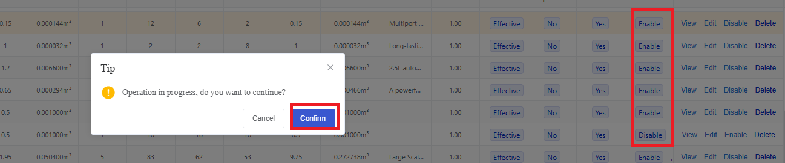

*Figure 9. Disable SKU screen from the CSG ERP User Manual.*

**Steps**

Navigate to Product → SKU List.

Select the SKU.

Click Disable.

Confirm the action.

**Notes**

Disabled SKUs remain in the system for historical reference.

Existing inventory and transaction records are preserved.

A disabled SKU cannot normally be used for new business transactions until it is enabled again.

The barcode remains associated with the disabled SKU and cannot be reused for another SKU.

Use Disable when a product is discontinued or temporarily unavailable but historical records need to be retained.

#### 7.2.10 Delete SKU

The Delete function permanently removes a SKU record from the system.

**Steps**

Navigate to Product → SKU List.

Select the SKU to be removed.

Click Delete.

Confirm the deletion.

**Notes**

A SKU cannot be deleted if it has been used in business transactions, such as Inbound Receipts, Inventory, Outbound Orders, or other related records.

Delete is intended only for unused or incorrectly created SKU records.

If the SKU is no longer required but has existing transaction history, use Disable instead of Delete.

### 7.3 Sales Kit list

#### 7.3.1 Overview

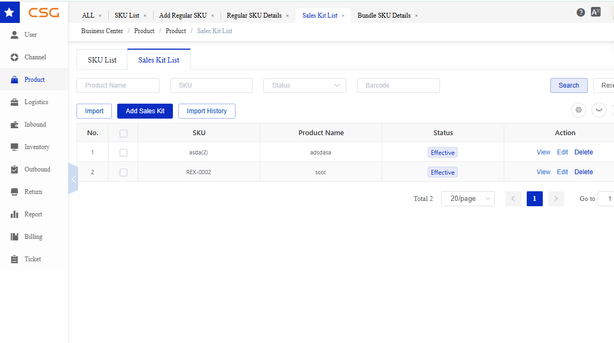

*Figure 10. Overview screen from the CSG ERP User Manual.*

The Sales Kit List is used to manage bundled products (Sales Kits) within the Customer Portal.

A Sales Kit is a bundle product composed of multiple individual SKUs. Although it is sold as a single product, the system automatically expands the Sales Kit into its component SKUs during order fulfillment. Inventory is allocated and deducted based on the component SKUs rather than the Sales Kit itself.

Users can:

Search Sales Kits

Create new Sales Kits

Import Sales Kit information

View Sales Kit details

Edit Sales Kits

Delete Sales Kits

Navigation

The Sales Kit List page displays all Sales Kits created under the customer account.

**Note:** All component SKUs must already exist in the SKU List before they can be added to a Sales Kit.

#### 7.3.2 Sales Kit List Information

Available Functions

| Function | Description |
| --- | --- |
| Search | Search Sales Kit records. |
| Reset | Clear all search conditions. |
| Import | Import Sales Kit records in bulk. |
| Add Sales Kit | Create a new Sales Kit. |
| Import History | View previous Sales Kit import records. |

Sales Kit Information

| Field | Description |
| --- | --- |
| No. | System sequence number. |
| SKU | Sales Kit SKU code. |
| Product Name | Sales Kit product name. |
| Status | Current Sales Kit status. |
| Action | Available actions for the Sales Kit. |

#### 7.3.3 Search Filters

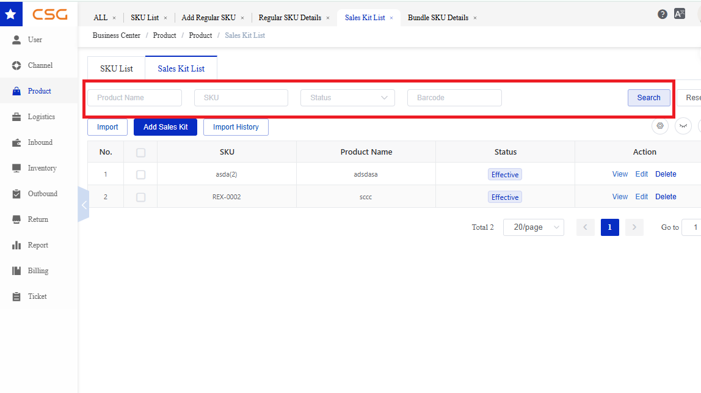

*Figure 11. Search Filters screen from the CSG ERP User Manual.*

Users can search Sales Kit records using the following criteria:

| Field | Description |
| --- | --- |
| Product Name | Search by Sales Kit product name. |
| SKU | Search by Sales Kit SKU. |
| Status | Filter by Sales Kit status. |

**Steps**

Enter one or more search conditions.

Click Search.

Review the matching Sales Kit records.

#### 7.3.4 Add Sales Kit

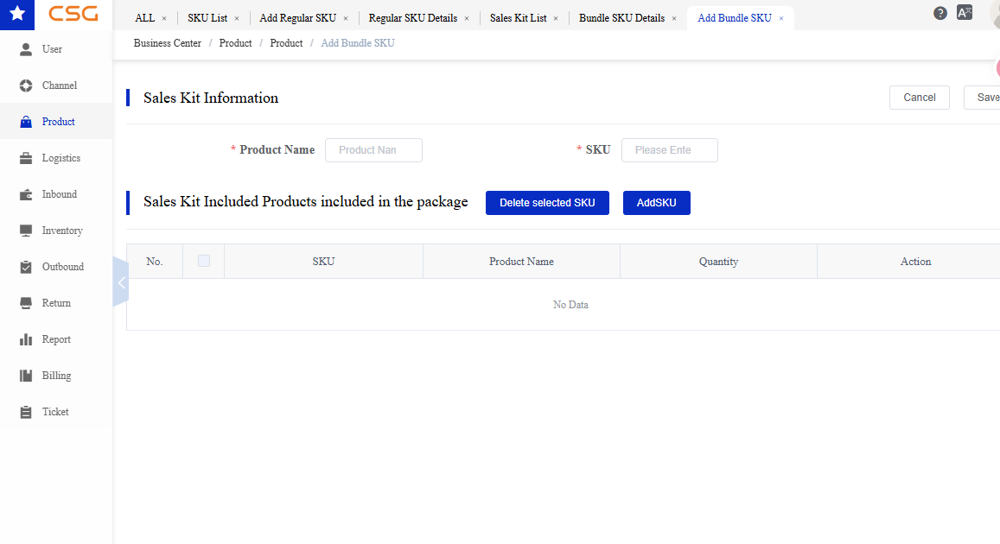

*Figure 12. Add Sales Kit screen from the CSG ERP User Manual.*

Users can create a new bundled product by combining multiple SKUs into a single Sales Kit.

**Steps**

Navigate to Product → Sales Kit.

Click Add Sales Kit.

Enter the Sales Kit information.

Select the component SKUs.

Enter the quantity for each component SKU.

Click Save.

**Notes**

The Sales Kit SKU must be unique.

All component SKUs must already exist in the SKU List.

A Sales Kit must contain at least one component SKU.

#### 7.3.5 Import Sales Kit

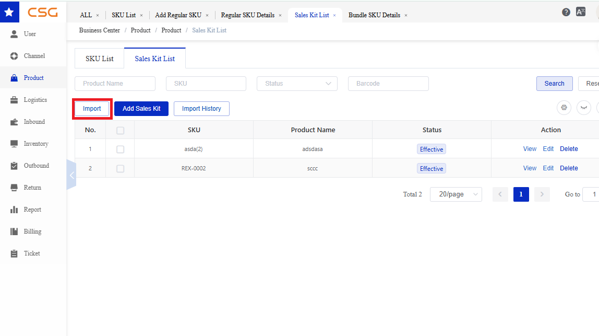

*Figure 13. Import Sales Kit screen from the CSG ERP User Manual.*

Users can import multiple Sales Kits using an import template.

**Steps**

Download the Sales Kit template (if available).

Complete the required Sales Kit information.

Click Import.

Upload the completed file.

Review the import result.

**Notes**

Import data must follow the provided template.

Component SKUs must already exist in the SKU List.

Invalid SKU Codes will cause the import to fail.

#### 7.3.6 View Sales Kit Details

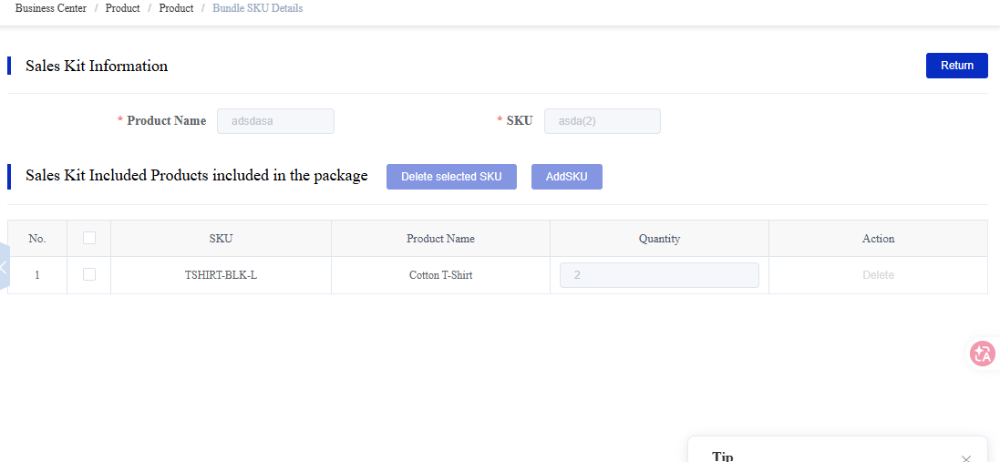

*Figure 14. View Sales Kit Details screen from the CSG ERP User Manual.*

Users can click View to check the products included in a Sales Kit.

The Sales Kit Details page displays:

Sales Kit SKU

Product Name

Component SKU List

Quantity of each component SKU

Status

#### 7.3.7 Edit Sales Kit

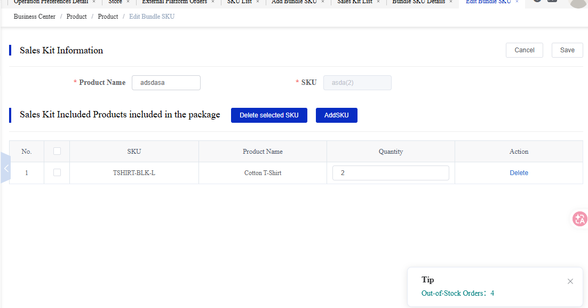

*Figure 15. Edit Sales Kit screen from the CSG ERP User Manual.*

Users can modify an existing Sales Kit by updating its basic information or maintaining the component SKU list.

Available actions include:

Update the Sales Kit name

Add component SKUs

Remove component SKUs

Modify the quantity of component SKUs

Save the changes

**Note:** Component SKUs must exist in the SKU List before they can be added to a Sales Kit.

#### 7.3.8 Delete Sales Kit

Users can permanently remove a Sales Kit from the system.

**Steps**

Navigate to Product → Sales Kit.

Locate the required Sales Kit.

Click Delete.

Confirm the deletion.

**Notes**

Deleted Sales Kits cannot be recovered.

Sales Kits referenced by active orders or other system processes may not be deleted.

## 8. Logistics

The Logistics module maintains logistics-related configurations used when warehouse orders are dispatched through available delivery services.

### 8.1 Overview

The logistics module allows users to view and manage logistics providers, courier services, and postcode mappings available in the CSG system.

This module is mainly used to:

• View available logistics providers • Check courier service configurations • Verify service availability and status • Manage postcode mappings used for shipping allocation • Support order fulfillment and carrier selection

The logistics module includes:

• Logistics Provider • Logistics Service • Postcode

### 8.2 Logistics Provider

#### 8.2.1 Overview

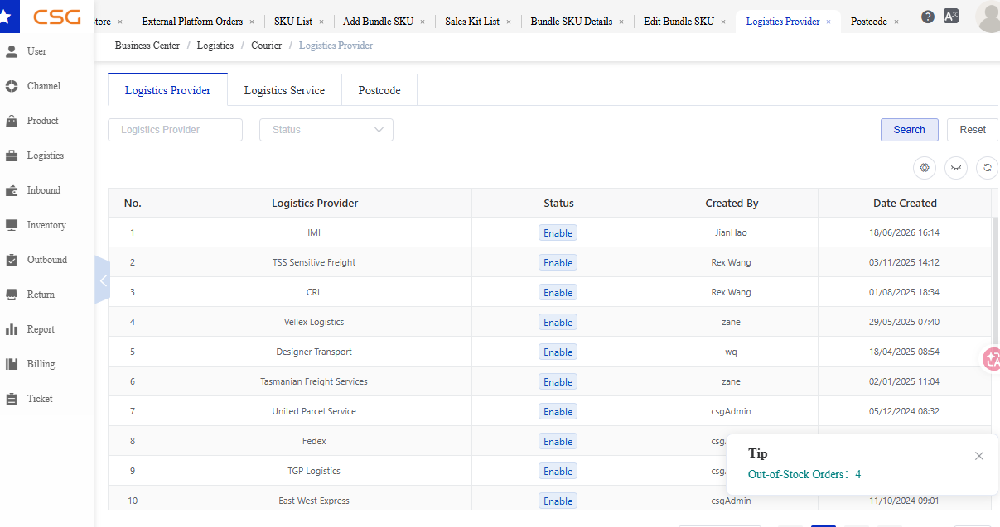

*Figure 1. Overview screen from the CSG ERP User Manual.*

Navigation

The Logistics Provider page displays all logistics companies configured in the system.

Users can search and view provider information.

#### 8.2.2 Search Filters

Users can search logistics providers by:

| Field | Description |
| --- | --- |
| Logistics Provider | Logistics company name |
| Status | Provider status |

#### 8.2.3 Logistics Provider Information

The Logistics Provider table displays the following information.

| Column | Description |
| --- | --- |
| Logistics Provider | Name of the logistics company |
| Status | Provider availability |
| Created By | User who created the provider record |
| Date Created | Record creation date |

#### 8.2.4 Status

| Status | Description |
| --- | --- |
| Enable | Provider is available for use |
| Disable | Provider is unavailable for selection |

### 8.3 Logistics Service

#### 8.3.1 Overview

Navigation

The Logistics Service page displays courier services available under each logistics provider.

Users can view service information and verify service availability.

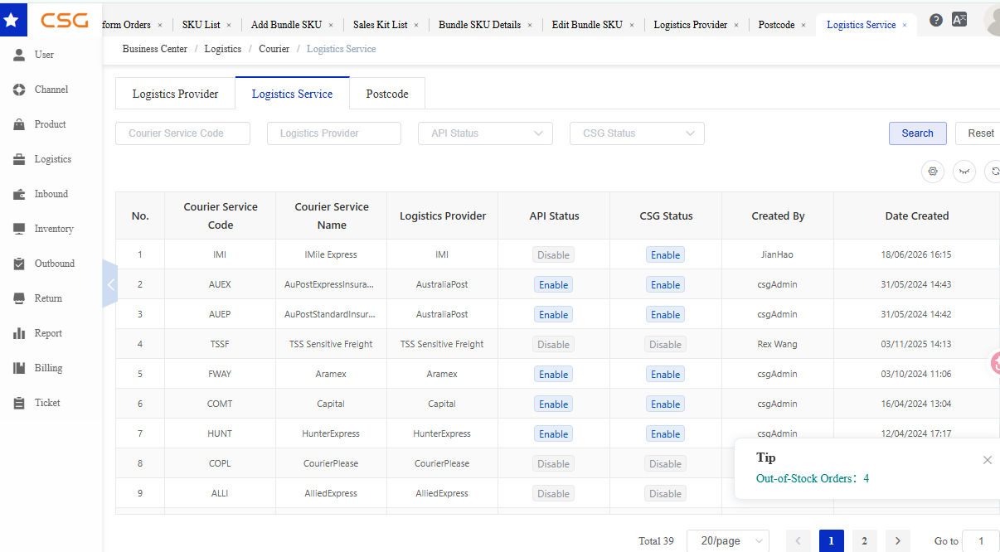

*Figure 2. Overview screen from the CSG ERP User Manual.*

#### 8.3.2 Search Filters

Users can search courier services by:

| Field | Description |
| --- | --- |
| Courier Service Code | Service identifier |
| Courier Service Name | Service name |
| Logistics Provider | Related logistics provider |
| API Status | API connection status |
| CSG Status | Service status within CSG |

#### 8.3.3 Logistics Service Information

The Logistics Service table displays the following information.

| Column | Description |
| --- | --- |
| Courier Service Code | Courier service code |
| Courier Service Name | Courier service name |
| Logistics Provider | Associated logistics provider |
| API Status | Courier API connection status |
| CSG Status | Service status in CSG |
| Date Created | Record creation date |

#### 8.3.4 Service Status

API Status

| Status | Description |
| --- | --- |
| Connected | API connection is active |
| Disconnected | API connection unavailable |
| Pending | Connection validation in progress |

CSG Status

| Status | Description |
| --- | --- |
| Enable | Service is available for shipment creation |
| Disable | Service cannot be used |

### 8.4 Postcode

#### 8.4.1 Overview

Navigation

The Postcode page displays postcode information used for logistics routing and service matching.

Users can search postcode records and verify delivery coverage.

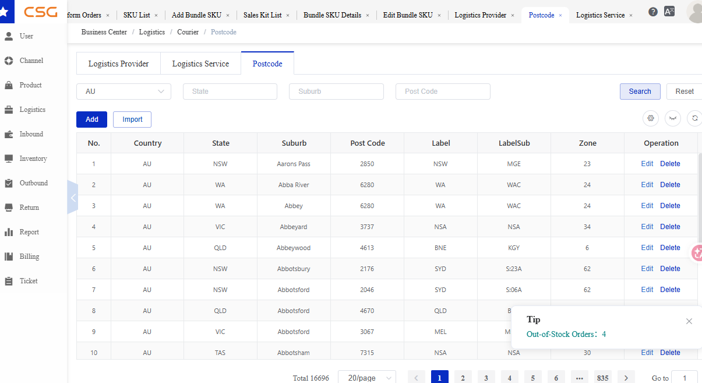

*Figure 3. Overview screen from the CSG ERP User Manual.*

#### 8.4.2 Postcode Information

Depending on system configuration, postcode records may include:

| Column | Description |
| --- | --- |
| Postcode | Postal code |
| State | State or region |
| Suburb | Delivery suburb |
| Logistics Provider | Assigned logistics provider |
| Courier Service | Available courier service |
| Status | Record status |

#### 8.4.3 Usage

Postcode mappings are used to:

- Determine delivery coverage
- Match available courier services
- Support shipping rate calculations
- Assist automatic logistics allocation

## 9. Inbound

The Inbound module is used to create and monitor stock-receipt instructions for goods being delivered to the warehouse.

### 9.1 Overview

The Inbound module is used to manage products received into the warehouse.

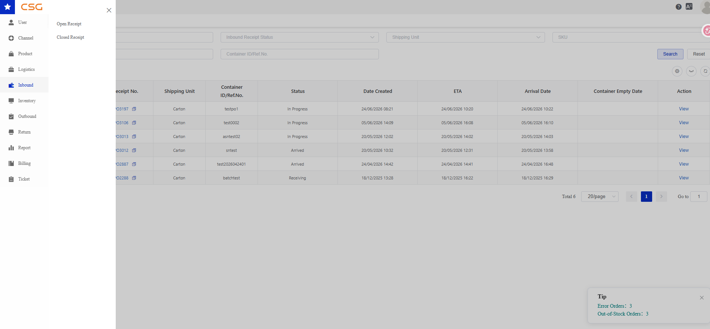

*Figure 1. Overview screen from the CSG ERP User Manual.*

The Inbound module is used to manage products being received into the warehouse.

In most business processes, an inbound receipt is created based on a Purchase Order (PO). When a PO is created, the corresponding receipt appears in the Open Receipt list, where warehouse staff record the actual quantities received and complete the receiving process.

Once all products have been received and confirmed, the receipt is moved to the Closed Receipt list.

The Inbound module includes:

Open Receipt – Displays inbound receipts that are waiting to be received or are currently being processed. Most Open Receipts are generated from Purchase Orders (POs).

Closed Receipt – Displays inbound receipts that have been completed or cancelled.

Relationship with Purchase Orders (PO)

A Purchase Order (PO) records what is expected to be delivered to the warehouse, while an Inbound Receipt records what is actually received.

During the receiving process, warehouse staff verify the delivered products against the PO and record any quantity differences or discrepancies before completing the receipt.

Relationship with Inventory

After an inbound receipt is completed, the received quantities are added to warehouse inventory and become available for allocation and outbound fulfillment.

### 9.2 Open Receipt

#### 9.2.1 Overview

Navigation

The Open Receipt page displays all inbound receipts that are currently active or being processed.

Users can:

Search inbound receipts

Create a new receipt

Export receipt records

View receipt details

Additional functions available on view page include:

Print – Print the receipt.

Operation Log – View the receipt operation history.

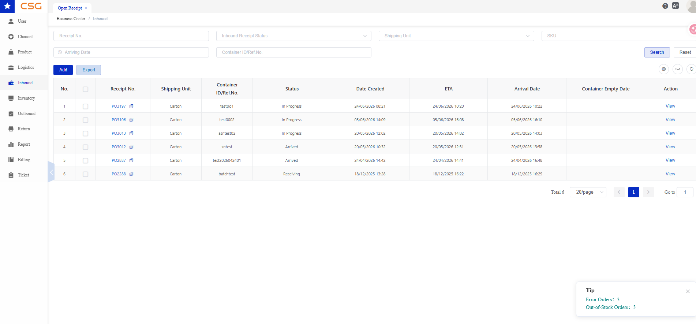

*Figure 2. Overview screen from the CSG ERP User Manual.*

#### 9.2.2 Receipt List Information

The Open Receipt list displays the following information.

| Field | Description |
| --- | --- |
| Receipt No. | Unique inbound receipt number. |
| Shipping Unit | Shipping unit (e.g. Carton, Pallet, Container). |
| Container ID / Ref. No. | Container number or supplier reference number. |
| Status | Indicates the current stage of the inbound receipt. Typical statuses include: • Pending – The receipt has been created but receiving has not started. • Receiving – Warehouse staff are currently receiving and verifying the products. • Completed – All products have been received successfully. The receipt is moved to Closed Receipt and inventory is updated. • Cancelled – The receipt has been cancelled and no inventory will be received. |
| Date Created | Date the receipt was created. |
| ETA | Estimated arrival date and time of the shipment. |
| Arrival Date | Actual date and time the shipment arrived at the warehouse. |
| Container Empty Date | Date the container was fully unloaded. |
| Action | View receipt details, receive products, or complete the receiving process (depending on the current status). |

#### 9.2.3 Search Receipt

Users can search inbound receipts using one or more filter conditions.

Search Criteria

| Field | Description |
| --- | --- |
| Receipt No. | Receipt number |
| Inbound Receipt Status | Receipt status |
| Shipping Unit | Shipping unit |
| SKU | Product SKU |
| Arrival Date | Arrival date |
| Container ID / Ref. No. | Container or reference number |

**Steps**

Navigate to Inbound → Inbound Receipt.

Enter one or more search conditions.

Click Search.

Review the matching records.

#### 9.2.4 Add Receipt

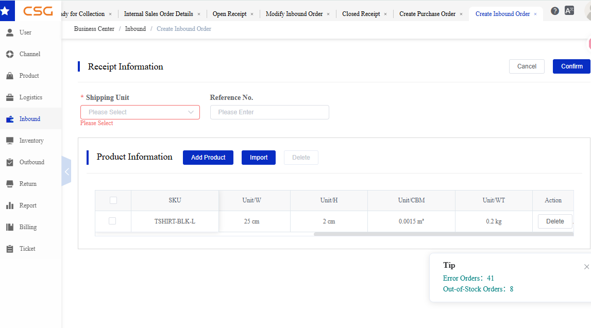

*Figure 3. Add Receipt screen from the CSG ERP User Manual.*

The Add Receipt function allows users to create a new inbound receipt for products arriving at the warehouse.

A newly created receipt is assigned the status New and is displayed in the Open Receipt list for warehouse receiving and processing.

Navigation

##### 9.2.4.1 Receipt Information

Before adding products, users must first complete the receipt information.

The required fields vary depending on the selected Shipping Unit.

##### 9.2.4.2 Shipping Unit

The Shipping Unit specifies how the goods are delivered to the warehouse. The system displays different receipt fields based on the selected shipment type.

Carton

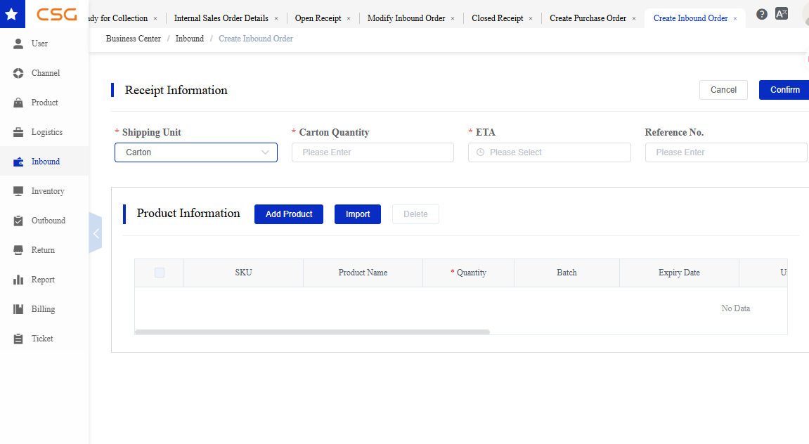

*Figure 4. Shipping Unit screen from the CSG ERP User Manual.*

Select Carton when the goods are delivered in individual cartons or boxes.

Required Fields

| Field | Description |
| --- | --- |
| Carton Quantity | Total number of cartons included in the shipment. |
| ETA | Estimated arrival date and time. |
| Reference No. | Shipment or supplier reference number (optional). |

Recommendation

Select Carton only when the shipment is physically received as cartons.

Ensure the carton quantity matches the actual shipment delivered to the warehouse.

Pallet

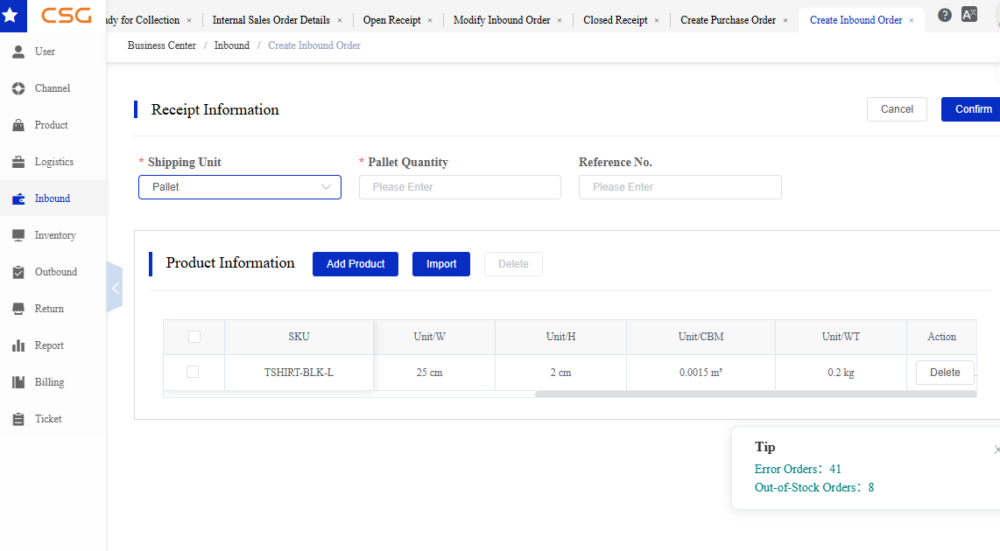

*Figure 5. Shipping Unit screen from the CSG ERP User Manual.*

Select Pallet when the goods are delivered on pallets.

Required Fields

| Field | Description |
| --- | --- |
| Pallet Quantity | Total number of pallets included in the shipment. |
| Reference No. | Shipment or supplier reference number (optional). |

Recommendation

Select Pallet only when the shipment is delivered on pallets.

Enter the correct pallet quantity to assist warehouse receiving and unloading.

Container

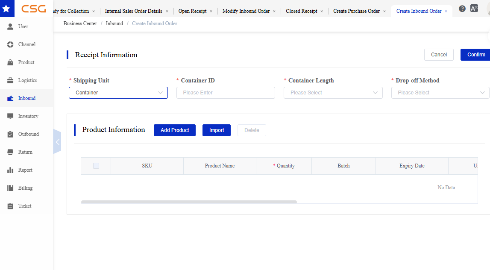

*Figure 6. Shipping Unit screen from the CSG ERP User Manual.*

Select Container when the goods are delivered in a shipping container.

Required Fields

| Field | Description |
| --- | --- |
| Container ID | Shipping container identification number. |
| Container Length | Select the size of the container (for example, 20 ft or 40 ft). |
| Drop-off Method | Select the method used to deliver the container to the warehouse. |

Recommendation

Select Container only for container shipments.

Ensure the container information is accurate to support warehouse scheduling and unloading.

**Important:** Select the Shipping Unit that matches the actual shipment. The selected Shipping Unit determines which receipt information must be completed.

##### 9.2.4.3 Product Information

The Product Information section displays all products added to the inbound receipt. Product details are automatically retrieved from the SKU List after a product is selected.

*Figure 7. Product Information screen from the CSG ERP User Manual.*

The following information is displayed.

| Field | Description |
| --- | --- |
| SKU | Unique product identifier. |
| Unit/L | Unit length of the product. |
| Unit/W | Unit width of the product. |
| Unit/H | Unit height of the product. |
| Unit/CBM | Cubic volume (CBM) of one unit. |
| Unit/WT | Weight of one unit. |
| Action | Remove the selected product from the current inbound receipt. |

**Functions**

| Function | Description |
| --- | --- |
| Add Product | Add one or more products from the existing SKU List. |
| Import | Import multiple products using the system import template. |
| Delete | Remove the selected product from the current inbound receipt. This action does not delete the product from the SKU List. |

**Notes**

Products must already exist in Product → SKU List before they can be added to an inbound receipt.

Product dimensions, weight, and CBM are automatically populated from the SKU master data.

Product information displayed in this section is read-only. To modify product dimensions or weight, update the SKU in .

The Delete action removes the product only from the current inbound receipt and does not delete the SKU or affect its inventory records.

##### 9.2.4.4 Add Product

*Figure 8. Add Product screen from the CSG ERP User Manual.*

The Add Product function allows users to select one or more products from the existing SKU List.

Only products that have already been created in can be selected.

**Steps**

Click Add Product.

Search for products by Product Name or SKU.

Select one or more products.

Click Confirm.

Enter the receiving quantity for each product.

**Notes**

Multiple products can be selected at the same time.

Products must already exist in the SKU List.

If Batch and Expiration is enabled for a SKU, users must enter the Batch Number and Expiry Date before confirming the receipt.

##### 9.2.4.5 Import Products

The Import function allows users to add multiple products to the inbound receipt using the system import template.

*Figure 9. Import Products screen from the CSG ERP User Manual.*

**Steps**

Click Import.

Download the import template if required.

Complete the template with the required product information.

Upload the completed template.

Review the imported products before confirming the receipt.

**Notes**

Only existing SKUs can be imported.

Invalid or duplicate records may be rejected during import.

Review imported quantities before confirming the receipt.

Batch and Expiration information must be provided for products that require batch management.

#### 9.2.5 Edit Receipt

*Figure 10. Edit Receipt screen from the CSG ERP User Manual.*

The Edit function allows users to update an existing inbound receipt before the receiving process begins.

**Important:** Only inbound receipts with the status New can be edited.

Navigation

Receipt Information

Users can update the receipt information before receiving begins.

| Field | Description |
| --- | --- |
| Shipping Unit | Update the shipment type (e.g. Carton, Pallet, or Container). |
| Pallet Quantity | Update the total number of pallets in the shipment. |
| ETA | Update the estimated arrival date and time. |
| Reference No. | Update the shipment, supplier, or container reference number. |

Product Information

Users can maintain the products included in the inbound receipt.

Available functions include:

Add Product – Add additional products from the existing SKU List.

Import – Import multiple products using the system import template.

Delete – Remove selected products from the current inbound receipt.

The Product Information table displays the following information.

| Field | Description |
| --- | --- |
| SKU | Product SKU code. |
| Product Name | Product name. |
| Quantity | Quantity to be received. |
| Unit Dimensions | Product dimensions automatically retrieved from the SKU master data. |
| Unit Weight | Product weight automatically retrieved from the SKU master data. |
| Unit CBM | Product volume automatically retrieved from the SKU master data. |

**Steps**

Navigate to Inbound → Inbound Receipt.

Locate a receipt with the status New.

Click Edit.

Update the receipt information if required.

Add, import, or remove products as necessary.

Update the product quantities.

Click Confirm to save the changes.

**Notes**

Only receipts with the status New can be edited.

Products must already exist in Product → SKU List before they can be added.

Product dimensions, weight, and CBM are automatically populated from the SKU master data and cannot be edited in the inbound receipt.

Removing a product from the receipt only removes it from the current receipt. It does not delete the SKU from the Product module.

Once the receipt status changes from New to another status, the receipt can no longer be edited.

### 9.3 Closed Receipt

#### 9.3.1 Overview

Navigation

The Closed Receipt page displays inbound receipts that have been completed or cancelled.

Completed and cancelled receipts are maintained for historical reference, inventory verification, and audit purposes. Once a receipt is closed, it becomes read-only and can no longer be edited.

Users can:

Add a new inbound receipt.

Search completed or cancelled receipts.

View receipt details.

**Notes**

Closed receipts are read-only and cannot be edited.

Completed receipts have already updated warehouse inventory.

Cancelled receipts are retained for historical reference and do not update inventory.

To receive a new shipment, click Add to create a new inbound receipt instead of modifying an existing closed receipt.

*Figure 11. Overview screen from the CSG ERP User Manual.*

#### 9.3.2 Closed Receipt Information

The Closed Receipt list includes the following information.

| Field | Description |
| --- | --- |
| Receipt No. | Inbound receipt number |
| Shipping Unit | Shipping unit |
| Container ID / Ref. No. | Container reference |
| Status | Receipt completion status |
| Date Created | Creation date |
| ETA | Estimated arrival time |
| Arrival Date | Actual arrival date |
| Container Empty Date | Container empty date |
| Completion Time | Time the receipt was completed |
| Action | View receipt details |

#### 9.3.3 View Receipt Details

*Figure 12. View Receipt Details screen from the CSG ERP User Manual.*

Click View to display the completed inbound receipt.

The detail page includes:

Receipt Information – Displays the receipt details, including status, shipping information, ETA, reference number, and comments.

Product Information – Displays all products included in the receipt, including SKU, quantity, dimensions, weight, batch number, and expiry date.

Available functions on this page:

| Function | Description |
| --- | --- |
| Print | Print the receipt information. |
| Operation Log | View the operation history of the receipt. |
| Return | Return to the previous receipt list without making changes. |

#### 9.3.4 Add Closed Receipts

*Figure 13. add closed receipts screen from the CSG ERP User Manual.*

The Add function allows users to create a new inbound receipt from the Closed Receipt page.

The creation process is the same as described in Section 9.2.4 Add Receipt.

Navigation

**Steps**

Follow the same steps described in Section 9.2.4 Add Receipt to create a new inbound receipt.

**Notes**

Creating a receipt from the Closed Receipt page follows the same process as creating a receipt from the Open Receipt page.

A receipt created from the Open Receipt page is created with the status New and appears in the Open Receipt list for further processing.

A receipt created from the Closed Receipt page is created with the status Done and is displayed in the Closed Receipt list.

For detailed instructions on entering receipt information and adding products, refer to Section 9.2.4 Add Receipt.

## 10. Inventory

The Inventory module provides visibility of warehouse stock, availability, movements, and other inventory information presented in the Customer Portal.

### 10.1 Overview

The Inventory module allows users to view current inventory levels, track inventory movements, and manage batch-controlled stock.

Users can:

View available inventory.

Search inventory records.

Export inventory information.

Track stock movement history.

Monitor inbound and outbound inventory changes.

Manage batch and expiration-controlled inventory.

The Inventory module includes:

Inventory Query

Stock Movement

Batch Inventory

*Figure 1. Overview screen from the CSG ERP User Manual.*

### 10.2 Inventory

#### 10.2.1 Overview

Navigation

The Inventory page displays current stock availability for all products stored in the warehouse.

Users can search inventory records and export inventory information.

*Figure 2. Overview screen from the CSG ERP User Manual.*

#### 10.2.2 Search Filters

Users can search inventory records using the following criteria:

| Field | Description |
| --- | --- |
| Product Name | Product name |
| SKU | Product SKU code |
| Yes/No | Inventory availability status |

#### 10.2.3 Main Functions

| Function | Description |
| --- | --- |
| Search | Search inventory records |
| Export | Export inventory information |

#### 10.2.4 Inventory Information

The inventory table displays the following information.

| Column | Description |
| --- | --- |
| SKU | Product SKU code |
| Product Name | Product description |
| Available | Available inventory quantity |
| In Stock | Total inventory quantity |
| Committed | Reserved inventory quantity |
| Warehouse Code | Warehouse identifier |
| Warehouse Name | Warehouse name |

Inventory Definitions

| Field | Description |
| --- | --- |
| Available | Quantity available for allocation |
| In Stock | Physical inventory quantity |
| Committed | Quantity reserved for orders |

Formula:

Available Inventory = In Stock - Committed

### 10.3 Stock Movement

#### 10.3.1 Overview

Navigation

The Stock Movement page displays inventory transaction history and quantity changes.

Users can track stock increases and decreases generated by warehouse operations.

*Figure 3. Overview screen from the CSG ERP User Manual.*

#### 10.3.2 Dashboard Summary

The dashboard displays inventory movement statistics.

| Indicator | Description |
| --- | --- |
| PO Inbound | Inventory received through purchase orders |
| Order Outbound | Inventory shipped through customer orders |
| Customer Returns | Inventory returned by customers |

#### 10.3.3 Search Filters

Users can search for movement records using:

| Field | Description |
| --- | --- |
| Date Range | Transaction date range |
| SKU Identity | Product SKU |
| Move Type | Inventory transaction type |

#### 10.3.4 Stock Movement Information

| Column | Description |
| --- | --- |
| Date | Transaction date |
| SKU Identity | Product SKU |
| Move Type | Inventory movement type |
| Qty Change | Quantity increase or decrease |
| Reference No | Related transaction reference |

### 10.4 Batch Inventory

#### 10.4.1 Overview

Navigation

The Batch Inventory page displays inventory managed by batch number and expiration date.

This page is mainly used for products requiring batch tracking and expiry management.

#### 10.4.2 Search Filters

Users can search for batch inventory using:

| Field | Description |
| --- | --- |
| SKU | Product SKU |
| Batch | Batch number |

#### 10.4.3 Batch Inventory Information

The batch inventory table displays the following information.

| Column | Description |
| --- | --- |
| SKU | Product SKU |
| Product Name | Product description |
| Available | Available inventory quantity |
| In Stock | Total inventory quantity |
| Committed | Reserved inventory quantity |
| Batch | Batch number |
| Expiration Date | Product expiration date |

## 11. Outbound

The Outbound module is used to create, review, and monitor orders that instruct the warehouse to pick, pack, and dispatch goods.

### 11.1 Overview

The Outbound Orders module is used to manage customer orders from order creation or synchronization through warehouse processing, shipment, or customer collection.

Outbound orders may be:

Synchronized from connected sales channels, such as Shopify, Shopify GraphQL, WooCommerce, or Unleashed.

Created manually in the CSG Customer Portal.

Imported in bulk using the system import function.

The Outbound Orders module includes:

Open Orders – Displays orders that are still awaiting processing, currently being processed, or require user attention.

Closed Orders – Displays orders whose outbound processing has ended, such as completed, shipped, collected, or cancelled orders, depending on the order status.

Open Orders and Closed Orders

| Section | Description |
| --- | --- |
| Open Orders | Orders that have not completed the outbound fulfillment process. Depending on their status, users may view, edit, cancel, reprocess, or perform other operations. |
| Closed Orders | Orders whose processing has ended. Closed orders are generally retained for shipment tracking, historical reference, and audit purposes. |

Relationship with Other Modules

Product provides the SKU and Sales Kit information used in outbound orders.

Channel synchronizes customer orders from external sales platforms.

Inventory provides available stock for order allocation.

Logistics provides the courier and shipping services used for delivery.

Sales Kits are expanded into their component SKUs during fulfillment.

### 11.2 Open Orders

#### 11.2.1 Overview

*Figure 1. Overview screen from the CSG ERP User Manual.*

Navigation

The Open Orders page displays outbound orders that have not yet completed the fulfillment process.

It includes newly created orders, orders being processed by the warehouse, orders with errors, orders with insufficient inventory, and orders awaiting shipment or collection.

Users can:

View all active outbound orders.

Search orders using multiple filter conditions.

Create manual outbound orders.

Import orders in bulk.

Export order information.

View order details.

Perform operations based on the current order status.

Review and resolve error or out-of-stock orders.

**Note:** The actions available for an order depend on its current status and the permissions assigned to the user.

#### 11.2.2 Open Order Categories

*Figure 2. Open Order Categories screen from the CSG ERP User Manual.*

The Open Orders page contains the following tabs.

| Tab | Description |
| --- | --- |
| All | Displays all open outbound orders, regardless of their current status. |
| New Orders | Displays newly created or synchronized orders that have not yet entered warehouse processing. |
| Processing Orders | Displays orders that have been accepted by the WMS and are currently being processed by the warehouse. |
| Error Orders | Displays orders that cannot proceed because of data validation, product matching, address, or integration errors. |
| Out-of-Stock Orders | Displays orders that cannot proceed because there is insufficient available inventory. |
| Waiting to be Shipped | Displays orders for which warehouse preparation has been completed and that are waiting for dispatch. |
| Ready for Collection | Displays pickup orders that are ready for collection by the customer or nominated carrier. |

#### 11.2.3 All Orders

Overview

The All tab displays every order currently included in Open Orders.

This page allows users to review orders across all open statuses without switching between individual tabs.

Available Functions

| Function | Description |
| --- | --- |
| Search | Search orders using the selected filter conditions. |
| Reset | Clear all search conditions. |
| Add | Manually create a new outbound order. |
| Import | Import outbound orders in bulk. |
| Export | Export order information based on the current search results. |
| View | Open the order details page. |
| Operate | Perform status-specific operations on the selected order. |
| Refresh | Refresh the page and retrieve the latest order information. |

Order List Information

The columns displayed may vary depending on the selected order tab.

| Field | Description |
| --- | --- |
| Receiver Name | Name of the order recipient. |
| Customer Order No. | Customer’s order reference number. |
| WMS Order No. | Order number generated by the Warehouse Management System. |
| Sales Channel | Platform or system from which the order originated. |
| Store | Store associated with the order. |
| Status | Current overall order status. |
| Operation Status | Current warehouse operation stage. |
| Label | Order or shipping label type, where applicable. |
| Shipping Method | Selected delivery or pickup method. |
| Ordered Date | Date and time the order was created. |
| ERP Received Date | Date and time the order was received by the CSG system. |
| Action | Available actions, such as View or Operate. |

#### 11.2.4 Search Open Orders

Users can search outbound orders using one or more filter conditions.

Search Criteria

| Field | Description |
| --- | --- |
| Sales Channel | Filter orders by source platform or system. |
| Store | Filter orders by connected store. |
| Order No. | Search by customer order number or related order number. |
| SKU Code | Search for orders containing a specific SKU. |
| Status | Filter by order status. |
| Shipping Method | Filter by delivery or collection method. |
| Date Range | Search for orders within a specified date range. |

**Steps**

Select the required order tab.

Enter one or more search conditions.

Click Search.

Review the matching orders.

**Notes**

Multiple search criteria can be combined.

Click Reset to clear all search conditions.

Search fields may vary slightly between individual order tabs.

#### 11.2.5 New Orders

Overview

The New Orders tab displays newly created, imported, or synchronized orders that have not yet entered warehouse processing.

Orders remain in this tab while the system validates information such as:

Customer and delivery details

Product and SKU matching

Inventory availability

Warehouse assignment

Shipping configuration

Typical Next Stage

If validation succeeds, the order moves to Processing Orders.

If validation fails:

Data problems may move the order to Error Orders.

Insufficient inventory may move the order to Out-of-Stock Orders.

#### 11.2.6 Processing Orders

Overview

The Processing Orders tab displays orders that have been accepted by the WMS and are currently being handled by the warehouse.

Typical warehouse activities include:

Inventory allocation

Picking

Packing

Label preparation

Shipment or collection preparation

Processing Order Information

| Field | Description |
| --- | --- |
| Customer Order No. | Customer order reference. |
| WMS Order No. | WMS processing order number. |
| Sales Channel | Source platform or system. |
| Store | Store associated with the order. |
| Status | Current order status. |
| Operation Status | Current warehouse processing stage. |
| Label | Assigned order or shipping label. |
| Shipping Method | Selected delivery method. |
| Ordered Date | Date the order was created. |
| Action | View or operate the order. |

**Note:** Once an order enters Processing, editing and cancellation are available only during the initial processing window. After the order has remained in Processing for approximately one hour, these actions may no longer be available. Always use the actions currently shown in the portal to determine whether the order can still be changed or cancelled.

#### 11.2.7 Error Orders

Overview

The Error Orders tab displays orders that cannot proceed because of validation, product, address, or integration errors.

Common Error Types

| Error Type | Description |
| --- | --- |
| Delivery Address Anomaly | The receiver address contains missing, invalid, or inconsistent information. |
| Product Matching Error | A product or SKU from the source order cannot be matched to a product in the CSG Product module. |

Other errors may appear depending on the order source and system configuration.

Available Functions

| Function | Description |
| --- | --- |
| View | View the order and error details. |
| Operate | Perform an available corrective or cancellation action. |
| BulkCancel | Cancel multiple selected error orders. |

Handling an Error Order

Open the order using View.

Review the Error Type and Error Details.

Correct the source data or related system configuration.

Use the available Operate or reprocessing function, where applicable.

Confirm that the order proceeds to the next status.

**Notes**

For a Product Matching Error, verify that the source SKU exactly matches a SKU or Sales Kit configured in the Product module.

For a Delivery Address Anomaly, verify the country, state, suburb, postcode, and street address.

Cancelling an order stops further warehouse processing.

#### 11.2.8 Out-of-Stock Orders

Overview

The Out-of-Stock Orders tab displays orders that cannot proceed because there is insufficient available inventory for one or more products.

This can affect:

Individual SKUs

Batch-controlled products

Component SKUs included in a Sales Kit

Available Functions

| Function | Description |
| --- | --- |
| Export | Export the selected out-of-stock order information. |
| Export SKU | Export SKU information associated with out-of-stock orders. |
| Bulk Cancel | Cancel multiple selected orders. |
| Reprocess Order | Recheck inventory and attempt to process the order again. |
| View | View the order details. |
| Operate | Perform available order operations. |

**Notes**

Ensure sufficient available inventory exists before reprocessing.

Completing an inbound receipt may replenish inventory for the affected SKU.

A Sales Kit remains out of stock if any required component SKU has insufficient inventory.

Reprocessing does not create inventory; it only checks inventory again.

#### 11.2.9 Waiting to be Shipped

Overview

The Waiting to be Shipped tab displays delivery orders that have completed the required warehouse preparation and are waiting for shipment or dispatch confirmation.

Typical completed activities include:

Inventory allocation

Picking

Packing

Shipping label preparation

Once shipment is confirmed, the order is moved to Closed Orders.

**Note:** Waiting to be Shipped is generally used for courier or freight delivery orders rather than customer pickup orders.

#### 11.2.10 Ready for Collection

Overview

The Ready for Collection tab displays pickup orders that have been prepared and are ready for collection by the customer, nominated person, or carrier.

These orders generally use a pickup shipping method rather than a standard courier delivery service.

Once collection is confirmed, the order is moved to Closed Orders.

**Notes**

Verify the collector’s details before releasing the order.

Follow the configured Proof of Dispatch or photo requirements if enabled in Operation Preferences.

Ready for Collection orders should not be processed as standard courier shipments.

#### 11.2.11 Add Order

##### 11.2.11.1 Overview

The Add Order function allows users to manually create an outbound order in the CSG Customer Portal.

Before creating an outbound order, at least one Sales Channel must be available in Channel Management, because the Sales Channel is a required field when creating the order.

A manually created outbound order is not restricted to the Manual Order channel. Users may select any available Sales Channel and associated Store according to how the customer wants the order to be classified, managed, and reported.

Navigation

**Important:** If no Sales Channel is available, configure the required channel or store under Channel → Store before creating the outbound order.

**Note:** The selected Sales Channel is used to classify the order. It does not necessarily indicate whether the order was originally created internally or synchronized from an external platform.

##### 11.2.11.2 Order Information

The Order Information section records the source, shipping arrangement, and general instructions for the outbound order.

Before creating a manual outbound order, at least one Sales Channel and Store must already exist in Channel Management.

A manually created order is not limited to the Manual Order channel. Users may select any available Sales Channel and Store according to how the order should be classified and reported.

General Order Information

| Field | Required | Description |
| --- | --- | --- |
| Customer Order No. | Must | Enter a unique customer order reference used to identify the order in the Customer Portal and WMS. |
| Sales Channel | Must | Select an existing Sales Channel for order classification. The selection is not limited to ManualOrder. |
| Store | Must | Select the Store associated with the selected Sales Channel. |
| Shipping Method | Must | Select how the order will be delivered or collected. The selected method determines the logistics booking process and displays the corresponding additional fields. |
| Ordered Date | Must | Date and time when the order was created. The system may automatically populate the current date and time. |
| Customer Comments | Optional | Enter packing instructions, delivery requirements, collection details, or other special-handling information. |
| Supporting Documents | Optional | Upload documents such as packing lists, picking instructions, booking documents, or other supporting files. The maximum file size is 5 MB. |

**Notes**

The Customer Order No. should be unique to prevent duplicate orders.

A Sales Channel and Store must exist before the order can be created.

The Sales Channel is used to classify the order and does not necessarily indicate whether the order was created internally or received from an external platform.

Select the Shipping Method carefully because it determines who arranges the courier, which additional fields are required, and whether the order is delivered or collected.

The fields displayed in the Order Information and Receiver Information sections may change according to the selected Shipping Method.

Shipping Method

The Shipping Method determines how the order will be fulfilled and who is responsible for arranging the courier, freight booking, or collection.

The system supports the following methods:

| Shipping Method | Description |
| --- | --- |
| Standard | Uses a normal delivery service for routine, non-urgent orders. |
| Express | Uses an expedited or priority delivery service for urgent orders. |
| CSG Manual Booking | CSG manually reviews the shipment and arranges the courier or freight booking. This method is normally used for large, complex, or special-handling orders. |
| Customer Manual Booking | The customer arranges the courier or freight booking and provides the required booking details and shipping documents. |
| Pickup | The order is prepared by the warehouse and collected later by the customer or a nominated carrier. |

- Standard
Select Standard for normal delivery orders that do not require expedited or special freight arrangements.

The order will use the standard logistics workflow and the courier services available for the selected Store.

No additional manual-booking fields are displayed for this method.

**Note:** Courier availability may depend on the Store’s Logistics Distribution configuration, destination postcode, shipment dimensions, and service availability.

- Express
Select Express when the order requires a faster or priority delivery service.

No additional manual-booking fields are displayed for this method.

**Note:** Express delivery may have shorter delivery times and higher freight charges than Standard delivery. Availability depends on the destination and configured courier services.

- CSG Manual Booking
Select CSG Manual Booking when the order requires manual review and intervention by the CSG Operations Team.

This method is generally used when:

The order is large or operationally complex.

Special freight or handling arrangements are required.

Automatic logistics allocation is not suitable.

CSG must contact and book a courier or freight provider manually.

A freight quotation or customer confirmation may be required.

Supporting documents or special instructions need to be reviewed.

Orders using CSG Manual Booking should be manually created so that the required shipment details can be reviewed before booking.

Additional Fields

| Field | Required | Description |
| --- | --- | --- |
| Confirm Quote | Conditional | Determines whether the customer must approve the freight quotation before CSG confirms the booking. |
| Dedicated Courier | Optional | Enable this option when a specific courier service must be used for the shipment. |
| Courier Service | Conditional | Select the required courier service. This field is required when a dedicated courier must be assigned. |
| Supporting Documents | Optional | Upload freight instructions, shipment requirements, packing documents, or other information required for manual review. |

Confirm Quote

The Confirm Quote setting determines whether customer approval is required before CSG confirms the courier or freight booking.

| Setting | Description |
| --- | --- |
| On | CSG obtains a freight quotation and sends it to the customer for approval. The booking will not be confirmed until the customer approves the quotation. |
| Off | Separate customer approval is not required. CSG may proceed with the booking according to the agreed logistics arrangement. |

##### 11.2.11.3 Receiver Information

Enter the delivery information for the order recipient.

| Field | Required | Description |
| --- | --- | --- |
| Full Name | Must | Full name of the recipient. |
| Phone Number | Must | Contact number for delivery communication. |
| Postal Email Address | Optional | Email address used for shipment or delivery notifications. |
| Country | Must | Destination country. |
| State | Must | Destination state or province. |
| Suburb | Must | Destination suburb or city. |
| Postcode | Must | Postal or ZIP code used for delivery routing. |
| Delivery Address 1 | Must | Primary delivery address. |
| Delivery Address 2 | Optional | Additional address information, such as unit, apartment, building, or floor number. |

**Important:** Check all receiver and address information carefully. An incorrect postcode, state, suburb, phone number, or delivery address may cause logistics allocation errors, delivery delays, or order cancellation.

##### 11.2.11.4 Product Information

The Product Information section is used to add the products included in the outbound order.

Product Fields

| Field | Description |
| --- | --- |
| Product Name | Name of the selected product or Sales Kit. |
| SKU | Unique product or Sales Kit identifier. |
| Batch | Batch selected for a batch-controlled product, where applicable. |
| Quantity | Quantity ordered. |
| Available | Current available inventory for the selected SKU. |
| Action | Remove the selected line from the current order. |

Available Functions

| Function | Description |
| --- | --- |
| Add Product | Add one or more individual products from the SKU List. |
| Add Sales Kit | Add a predefined Sales Kit from the Sales Kit List. |
| Delete in Batches | Remove multiple selected product lines from the current order. |

**Notes**

Individual products must already exist in .

Sales Kits must already exist in .

Review the Available quantity before saving the order.

Products with insufficient inventory may cause the order to enter Out-of-Stock Orders.

Removing a product line from the order does not delete the SKU from the Product module.

##### 11.2.11.5 Add Product

The Add Product function allows users to select individual physical products from the existing SKU List.

**Steps**

Click Add Product.

Search by Product Name or SKU if required.

Select one or more products.

Click Confirm.

Enter the required quantity.

Review the available inventory.

**Notes**

Multiple products can be selected at the same time.

Only enabled SKUs can normally be used for new orders.

The SKU must already exist in the Product module.

##### 11.2.11.6 Add Sales Kit

The Add Sales Kit function allows users to add a predefined product bundle to the outbound order.

A Sales Kit is sold as one product but consists of multiple component SKUs.

During warehouse fulfillment, the system allocates and deducts inventory from the component SKUs rather than from the Sales Kit itself.

**Steps**

Click Add Sales Kit.

Search for the required Sales Kit.

Select the Sales Kit.

Click Confirm.

Enter the required Sales Kit quantity.

Review component inventory availability.

**Notes**

A Sales Kit does not normally maintain independent inventory.

Inventory availability is determined by the stock of its component SKUs.

If any required component SKU has insufficient inventory, the order may enter Out-of-Stock Orders.

Sales Kits are available in Outbound because the warehouse may need to pick and pack multiple component SKUs as one customer bundle.

##### 11.2.11.7 Save Order

After completing the order:

Review the Order Information.

Verify the Receiver Information.

Confirm all products, Sales Kits, and quantities.

Review available inventory.

Click Save.

The order will be created and displayed in New Orders for validation and warehouse processing.

#### 11.2.12 Import Orders

The Import function allows users to create multiple outbound orders in bulk.

*Figure 3. Import Orders screen from the CSG ERP User Manual.*

**Steps**

Navigate to Outbound → Outbound Order.

Click Import.

Prepare the import file according to the required system format.

Select and upload the completed file.

Review the import results.

Correct any rejected or invalid records if required.

**Notes**

SKUs in the import file must already exist in the Product module.

Customer order numbers should be unique.

Missing receiver information, invalid addresses, unmatched SKUs, or incorrect data may cause orders to be rejected or moved to Error Orders, depending on system rules.

Review imported orders before warehouse processing begins.

#### 11.2.13 Export Orders

The Export function allows users to download order records for reporting, review, or reconciliation.

**Steps**

Apply the required search filters.

Click Search.

Click Export.

Download the generated file.

**Note:** The exported data normally reflects the current search conditions and selected order tab.

### 11.3 Closed Orders

#### 11.3.1 Overview

*Figure 4. Overview screen from the CSG ERP User Manual.*

The Closed Orders module contains outbound orders that have reached the end of their lifecycle.

Orders in this module are no longer processed by the warehouse and are retained for historical reference, reporting, and auditing.

The module is divided into three categories:

All Orders – Displays all closed orders.

Completed Orders – Displays successfully fulfilled orders.

Cancelled Orders – Displays cancelled orders.

#### 11.3.2 All Orders

*Figure 5. All Orders screen from the CSG ERP User Manual.*

The All Orders tab displays every closed outbound order, including both completed and cancelled orders.

Users can search historical records, review order details, and perform actions that are available based on the order status.

Available Functions

| Function | Description |
| --- | --- |
| View | Display the complete order details. |
| Copy | Available only for cancelled orders. Creates a new outbound order using the selected cancelled order as a template. |
| Export | Export the current search results. |
| Full Export | Export all closed order records. |

#### 11.3.3 Completed Orders

*Figure 6. Completed Orders screen from the CSG ERP User Manual.*

The Completed Orders tab displays orders that have been successfully fulfilled.

Completed orders are read-only records and cannot be modified or copied.

Available Functions

| Function | Description |
| --- | --- |
| View | Display the complete information for the selected completed order. |

View Order

*Figure 7. Completed Orders screen from the CSG ERP User Manual.*

*Figure 8. Completed Orders screen from the CSG ERP User Manual.*

Click View to display the complete information for the selected completed order.

The order details page contains the following sections:

| Section | Description |
| --- | --- |
| Order Information | Displays the order type, status, customer order number, WMS order number, store, order creation times, comments, shipping method, and receiver information. |
| Shipping Documents | Displays shipping method, shipping label, courier service information, quotation details, and shipping-related documents. |
| Product Information | Displays all products included in the order, including SKU, batch, quantity, pre-allocation status, and rating status. Users can switch between Summarize by Product and By Product Line Details. |
| Logistics Information | Displays shipping labels, courier information, tracking number (Job ID/Tracking No.), courier service, and rating results generated during shipment. |
| Log | Displays the complete operation history of the order for auditing and tracking purposes. |

**Notes**

Completed orders are read-only and cannot be edited.

All information displayed reflects the final completed order.

Shipping labels and tracking information are available if they were generated during fulfillment.

The Log button provides a complete history of actions performed on the order.

#### 11.3.4 Cancelled Orders

The Cancelled Orders tab displays orders that were cancelled before completion.

Users can review the cancelled order or create a new order by using the Copy function.

Available Functions

| Function | Description |
| --- | --- |
| View | Display the complete information for the selected cancelled order. |
| Copy | Open the Sales Order Entry page and create a new outbound order using the cancelled order information as a template. |

**Notes**

The original cancelled order remains unchanged.

The copied order is treated as a new outbound order and follows the standard outbound workflow after it is saved.

Users can modify the copied order information before saving.

View Order

*Figure 9. Cancelled Orders screen from the CSG ERP User Manual.*

Click View to display the complete information for the selected cancelled order.

The order details page displays:

| Section | Description |
| --- | --- |
| Flow Status | Displays the reason why the order was cancelled or could not continue processing, if applicable. |
| Order Information | Displays the original order information, including customer order number, order date, store, shipping method, customer comments, and receiver details. |
| Product List | Displays all products contained in the cancelled order, including SKU, external SKU, quantity, and available inventory information. |

**Notes**

Cancelled orders are read-only and cannot be modified.

The displayed information reflects the original order before cancellation.

Copy Order

*Figure 10. Cancelled Orders screen from the CSG ERP User Manual.*

Click Copy to create a new order using the cancelled order as a template.

The system opens the Sales Order Entry page and automatically copies the original order information, including:

Order Information

Receiver Information

Product Information

Shipping Method

Customer Comments

Users can modify the copied information, add or remove products, update quantities, and then click Save to create a new order.

**Notes**

A new customer order number is generated for the copied order.

The copied order is treated as a new order and follows the normal outbound order processing workflow.

Changes made to the copied order do not affect the original cancelled order.

## 12. Returns Management

Returns Management is used to create and monitor return instructions and the warehouse processing of returned goods.

### 12.1 Overview

The Returns module is used to manage customer goods returned after outbound shipment. Returned products are inspected by the warehouse: products in acceptable condition can be returned to inventory, while damaged or otherwise non-conforming products are recorded and reported for follow-up. Users can create return requests, record returned items, monitor return processing, and review completed return records.

The module contains two sections:

Open Return List – Displays return requests that are still being processed and allows users to create, edit, or delete return requests.

Close Return List – Displays completed return records for reference and auditing.

### 12.2 Open Return List

Overview

*Figure 1. Open Return List screen from the CSG ERP User Manual.*

*Figure 2. Open Return List screen from the CSG ERP User Manual.*

The Open Return List displays return requests that are currently being processed.

Users can:

Search return requests

Create a new return request

View return details

Edit return information

Delete a return request

Available Functions

| Function | Description |
| --- | --- |
| Search | Search return requests using available filters. |
| View | View the details of a return request. |
| Add Return | Create a new return request. |
| Edit | Modify an existing return request before it is completed. |
| Delete | Delete a return request that is no longer required. |

Add Return

*Figure 3. Open Return List screen from the CSG ERP User Manual.*

Click Add Return to create a new return request.

The following information can be entered:

Tracking Number

Associated Order Number

Third-party Platform ID

Returned Products

Return Quantity

Good Quality Processing

Handling of Non-conforming Products

Click Add Returned Products to add one or more returned SKUs.

After all required information has been entered, click Confirm to create the return request.

**Notes**

Multiple returned products can be added to one return request.

Each returned product requires a processing method.

Required fields are marked with a red asterisk (*).

View Return

*Figure 4. Open Return List screen from the CSG ERP User Manual.*

Click View to display the complete return request information.

The Return Detail page includes:

| Section | Description |
| --- | --- |
| Return Information | Displays customer, tracking number, submission time, status, associated order number, and completion time (if available). |
| Application List | Displays the products submitted in the return request together with the requested return quantity and processing method. |
| Confirmation List | Displays the confirmed inspection result after the warehouse processes the returned goods. This section becomes available after the return is completed. |

Additional functions may include:

Return

Label Download

Operation Log

Edit Return

Click Operation -> Edit to modify an open return request.

*Figure 5. Open Return List screen from the CSG ERP User Manual.*

Users can update:

Tracking Number

Associated Order Number

Third-party Platform ID

Returned Products

Return Quantity

Good Quality Processing

Handling of Non-conforming Products

Click Confirm to save the changes.

**Notes**

Only return requests that are still open can be edited.

### 12.3 Close Return List

Overview

*Figure 6. Close Return List screen from the CSG ERP User Manual.*

The Close Return List displays return requests that have been completed.

Completed return requests are available for reference, tracking, and auditing.

*Figure 7. Close Return List screen from the CSG ERP User Manual.*

Available Functions

| Function | Description |
| --- | --- |
| Search | Search completed return records. |
| View | View the completed return details. |

View Completed Return

Click View to display the completed return record.

*Figure 8. Close Return List screen from the CSG ERP User Manual.*

The page includes:

Return Information

Application List

Confirmation List

Label Download

Operation Log

The Confirmation List displays the warehouse inspection result, including:

Confirmed returned quantity

Good product quantity

Defective product quantity

Good quality processing

Handling of non-conforming products

Good products can be returned to available inventory according to the confirmed processing result. Defective or non-conforming products are reported and handled according to the selected disposition.

**Notes**

Completed return records are read-only.

Completed return requests cannot be edited or deleted.

Overview

The Reports module provides statistical analysis of sales and return activities to help users monitor business performance over a selected time period.

Users can filter report data by date range and statistical period, then generate summary information.

**Note:** The Reports module is currently under development. Additional reporting functions and export capabilities will be added in future releases.

*Figure 9. Close Return List screen from the CSG ERP User Manual.*

## 13. Report

The Report module provides downloadable operational reports available to the customer through the Customer Portal.

### 13.1 Overview

*Figure 1. Overview screen from the CSG ERP User Manual.*

The Sales Statistics Table provides summary statistics for sales and return transactions within the selected period.

Users can filter data by:

Date Range

Statistical Period

Click Search to generate the report or Reset to clear all filters.

The report currently includes the following metrics:

| Field | Description |
| --- | --- |
| Sales Order QTY | Total number of sales orders. |
| Sold Item QTY | Total quantity of items sold. |
| Return Order QTY | Total number of return orders. |
| Return Item QTY | Total quantity of returned items. |

**Notes**

Report data is displayed according to the selected filter conditions.

If no matching records are found, the system displays No Data Available.

Additional report types and analytical functions will be introduced in future versions.

## 14. Billing & Invoice

Billing and Invoice provides access to billing information, invoices, and related financial records made available through the Customer Portal.

### 14.1 Overview

*Figure 1. Overview screen from the CSG ERP User Manual.*

The Billing & Invoice module allows users to view service invoices generated by the system, monitor outstanding balances, and download available invoices.

Users can search invoices by invoice number, billing period, or status to quickly locate specific billing records.

### 14.2 Rate Card

Overview

*Figure 2. Rate Card screen from the CSG ERP User Manual.*

Navigation

Billing → Rate Card

The Rate Card page allows users to search and review the service charge items available to the current account.

Rate Card information may include fees related to warehousing, handling, order processing, transportation, or other services, depending on the customer’s billing configuration.

Search

Users can search for a specific charge item.

| Field | Description |
| --- | --- |
| Charge Item | Enter the name or keyword of the required billing charge item. |

**Steps**

Navigate to Billing → Rate Card.

Enter the charge item name or keyword.

Click Search.

Review the matching rate-card records.

Click Reset to clear the search condition.

Available Functions

| Function | Description |
| --- | --- |
| Search | Displays rate-card records matching the entered Charge Item. |
| Reset | Clears the current search condition. |

### 14.3 My Invoice

Overview

*Figure 3. My Invoice screen from the CSG ERP User Manual.*

The My Invoice page displays all available service invoices associated with the current account.

Users can search invoice records using the available filters and review invoice details, payment status, and outstanding balances.

Available Functions

| Function | Description |
| --- | --- |
| Search | Search invoices using the specified filter conditions. |
| Reset | Clear all search criteria. |
| Download | Download available invoice documents. |

Search Filters

Users can filter invoice records using the following fields:

| Field | Description |
| --- | --- |
| Invoice No. | Search by invoice number. |
| Date Selection | Select the billing period (Year/Week). |
| Status | Filter invoices by payment status. |

Invoice Information

Each invoice record displays the following information:

| Field | Description |
| --- | --- |
| Invoice No. | Invoice reference number. |
| Year | Billing year. |
| Week | Billing week. |
| Invoice Date | Date the invoice was issued. |
| Total Amount | Total invoice amount. |
| Paid Amount | Amount that has been paid. |
| Outstanding Balance | Remaining unpaid amount. |
| Status | Current invoice status. |

**Notes**

The Total Balance displayed at the top of the page represents the total outstanding balance for the current account.

Only invoices available to the current account are displayed.

If no records match the search criteria, the system displays No Data Available.

Invoice download is available only for invoices with downloadable documents.

## 15. Ticket

The Ticket module allows customers to raise and monitor service or operational enquiries with CSG.

### 15.1 Overview

The Ticket Management module allows users to create, submit, track, and manage service requests through the CSG Customer Portal.

A ticket can be assigned to a department and service type, associated with relevant business records, and supported by descriptions and attachments. Users can monitor the ticket from submission through approval, processing, confirmation, and closure.

The Ticket module includes:

Open Ticket – Displays tickets that are still being drafted, approved, processed, or confirmed.

Closed Ticket – Displays completed, cancelled, or invalidated tickets retained for historical reference.

Ticket Workflow

The workflow shown on the Ticket Details page contains four main stages:

| Stage | Description |
| --- | --- |
| Submit | The ticket is submitted for review and approval. |
| Approve | The ticket is reviewed and approved by the responsible team. |
| In Process | The assigned department or operator processes the request. |
| Confirm | The completed work is reviewed and confirmed before the ticket is closed. |

**Note:** The exact actions available at each stage depend on the ticket status, assigned department, operator, and user permissions.

### 15.2 Open Ticket

#### 15.2.1 Overview

*Figure 1. Overview screen from the CSG ERP User Manual.*

Navigation

Ticket → Open Ticket

The Open Ticket page displays tickets that have not yet been completed or cancelled.

Users can:

Search active tickets

View tickets by processing category

Create a new ticket

Export ticket records

View ticket details

Perform available ticket operations

Monitor approval and processing dates

#### 15.2.2 Open Ticket Categories

##### 15.2.2.1 All

*Figure 2. All screen from the CSG ERP User Manual.*

The All tab displays every open ticket regardless of its current status.

Use this tab to review all active tickets from a single page.

##### 15.2.2.2 Draft

*Figure 3. Draft screen from the CSG ERP User Manual.*

The Draft tab displays tickets that have been saved but not yet submitted. Draft tickets can be reviewed and completed before entering the approval workflow.

*Figure 4. Draft screen from the CSG ERP User Manual.*

Typical actions include:

View the draft ticket

Continue editing the ticket

Add or remove relevant categories

Upload supporting files

Submit the ticket when ready

**Note:** Saving a ticket does not submit it for approval. The ticket remains in Draft until Submit is selected.

##### 15.2.2.3 Approval Pending

*Figure 5. Approval Pending screen from the CSG ERP User Manual.*

The Approval Pending tab displays submitted tickets that are waiting for approval.

At this stage:

The ticket has entered the approval workflow.

The responsible approver reviews the request.

The ticket cannot proceed to processing until approval is completed.

If approved, the ticket normally moves to Awaiting Processing.

If rejected, it moves to Approval Rejected.

##### 15.2.2.4 Awaiting Processing

*Figure 6. Awaiting Processing screen from the CSG ERP User Manual.*

The Awaiting Processing tab displays approved tickets that are waiting to be processed by the assigned department or operator.

The list may show:

Assigned department

Assigned operator

Approval time

Expected start time

Expected end time

Current status

The status may appear as Pending while processing has not yet started.

##### 15.2.2.5 In Progress

*Figure 7. In Progress screen from the CSG ERP User Manual.*

The In Progress tab displays tickets that are currently being handled by the assigned department or operator.

Users can monitor:

Assigned operator

Current status

Expected completion time

Processing progress

Available ticket operations

Once the requested work has been completed, the ticket normally moves to Confirmation Pending.

##### 15.2.2.6 Approval Rejected

*Figure 8. Approval Rejected screen from the CSG ERP User Manual.*

The Approval Rejected tab displays tickets that were rejected during the approval stage.

Users should:

Open the ticket using View.

Review the available rejection information or operation history.

Correct the ticket information where permitted.

Perform the available corrective or resubmission action.

**Note:** Available actions depend on the ticket status and user permissions.

##### 15.2.2.7 Confirmation Pending

*Figure 9. Confirmation Pending screen from the CSG ERP User Manual.*

The Confirmation Pending tab displays tickets for which processing has been completed but final confirmation is still required.

Users should review the completed service information before confirming the ticket.

Once confirmation is completed, the ticket moves to Closed Ticket → Completed.

#### 15.2.3 Search Open Tickets

Users can search open tickets using one or more filter conditions.

| Field | Description |
| --- | --- |
| Customer Name | Filter tickets by customer account. |
| Company Name | Search by the customer’s company name. |
| Ticket ID | Search by the unique ticket reference. |
| Department | Filter tickets by the department responsible for the request. |
| Customer Service | Filter tickets by the assigned customer service representative. |
| Operator | Filter tickets by the operator responsible for processing the ticket. |
| Date Range | Search for tickets within the selected date period. |

**Steps**

Navigate to Ticket → Open Ticket.

Select the required ticket category.

Enter one or more search conditions.

Click Search.

Review the matching tickets.

Click Reset to clear all search conditions.

#### 15.2.4 Open Ticket Information

The Open Ticket list may display the following information.

| Field | Description |
| --- | --- |
| No. | Sequence number of the ticket record. |
| Urgency Level | Priority level assigned to the ticket. |
| Customer Name | Customer associated with the ticket. |
| Company Name | Customer’s company name. |
| Ticket ID | Unique ticket reference assigned by the system. |
| Service | Type of service requested. |
| Customer Service | Customer service representative associated with the ticket. |
| Department | Department responsible for handling the ticket. |
| Operator | Staff member assigned to process the ticket. |
| Status | Current ticket status. |
| Creation Time | Date and time when the ticket was created. |
| Approval Time | Date and time when the ticket was approved. |
| Expected Start Time | Planned start date and time for processing. |
| Expected End Time | Planned completion date and time. |
| Completion Time | Actual ticket completion date and time, where available. |
| Action | Available actions, including View and Operate. |

#### 15.2.5 Common Functions

| Function | Description |
| --- | --- |
| Add | Create a new ticket. |
| Export | Export ticket records based on the current category and search conditions. |
| View | Open the Ticket Details page. |
| Search | Search tickets using the selected filter conditions. |
| Reset | Clear all search conditions. |

**Note:** Operate-menu options vary according to the ticket status, department, operator, and user permissions.

#### 15.2.6 View Ticket

*Figure 10. View Ticket screen from the CSG ERP User Manual.*

Click View to open the Ticket Details page.

The page displays the ticket workflow and all submitted information in read-only mode.

Workflow

The top of the page displays the current workflow stage:

Submit

Approve

In Process

Confirm

Ticket Information

The Ticket Information section may display:

Customer Name

Customer Service

Ticket ID

Department

Service

Relevant Categories

Ticket Description

Attachments

Relevant Category Information

Associated records may include:

Product Name

SKU

Barcode

Quantity or count

Other category-specific information

Attachments

Uploaded files are displayed on the page.

Click Download to download and review an attachment.

Operation Log

Click Operation Log to view the ticket’s activity history.

The log may record:

Ticket creation

Submission

Approval or rejection

Status changes

Assigned operator

Processing activities

Confirmation

Other user operations

Return

Click Return to go back to the ticket list.

#### 15.2.7 Add Ticket

Overview

*Figure 11. Add Ticket screen from the CSG ERP User Manual.*

The Add function allows users to create a new service ticket and submit it to the appropriate department.

Navigation

Ticket → Open Ticket → Add

The ticket can be saved as a draft or submitted into the approval workflow.

Ticket Information

| Field | Required | Description |
| --- | --- | --- |
| Customer Name | Must | Select or confirm the customer associated with the ticket. |
| Customer Service | System/Conditional | Displays the customer service representative associated with the account. |
| Ticket ID | System | Unique ticket reference assigned by the system. |
| Department | Must | Select the department responsible for handling the request. |
| Service | Must | Select the required service type. Available services may depend on the selected department. |
| Relevant Categories | Optional/Conditional | Select the type of business record to associate with the ticket, such as a product or SKU. |
| Ticket Description | Must | Provide a clear description of the issue or service request. The field supports up to 9,999 characters. |
| Attachment | Optional | Upload supporting documents, images, spreadsheets, or other files relevant to the request. |

Department and Service

The Department identifies the team responsible for handling the ticket.

Examples shown in the system include:

Inventory

Logistics

Inbound

Outbound

Billing

IT

The Service identifies the specific request within the selected department.

Examples may include:

Stock Inspection

Stock Take

Stock Stratification

Delivery Tracking

Return Label

Order Status Inquiry

Inbound Receipt Inquiry

ERP Technical Issue

**Note:** Available departments and services depend on system configuration.

Relevant Categories

The Relevant Categories function allows users to associate the ticket with related business records.

Depending on the selected category, the associated-record list may display:

| Field | Description |
| --- | --- |
| Count | Number of associated records. |
| Product Name | Name of the associated product. |
| SKU | SKU associated with the ticket. |
| Barcode | Product barcode, where available. |
| Action | Remove the selected associated record. |

**Steps**

Select a Relevant Category.

Click Add.

Select the required business record.

Confirm the selection.

Review the associated records displayed in the list.

Use Delete Selected to remove selected records from the ticket.

**Important:** Add relevant records whenever they can help the responsible team identify and process the request. For example, an inventory-check ticket should include the affected SKU.

Attachment

The Attachment section allows users to upload supporting files.

Attachments may include:

Inventory lists

Screenshots

Order documents

Shipping documents

Spreadsheets

Supporting evidence

After a file has been uploaded, it is displayed on the Ticket Details page and can be downloaded for reference.

Ticket Description

The Ticket Description should clearly explain:

The issue or service request

The affected product, order, shipment, or system area

The expected result

Any relevant quantities or dates

Any action already taken

Any supporting file attached to the ticket

A clear description helps the assigned department process the ticket accurately and efficiently.

Save and Submit

| Function | Description |
| --- | --- |
| Save | Save the ticket as a Draft without submitting it for approval. |
| Submit | Submit the completed ticket into the approval workflow. |
| Return | Return to the previous page without continuing the current operation. |

**Steps**

Complete the required Ticket Information.

Select the Department and Service.

Add relevant categories where applicable.

Upload supporting attachments where required.

Enter a detailed Ticket Description.

Click Save to retain the ticket as a Draft, or click Submit to begin the approval process.

#### 15.2.8 Ticket Operations

Draft Operations

The Draft category contains tickets that have been saved but have not yet been submitted for approval.

Because the ticket has not entered the formal approval and processing workflow, the creator can still modify, delete, submit, or change the assigned Customer Service representative.

The following operations are available for Draft tickets.

Edit

*Figure 12. Ticket Operations screen from the CSG ERP User Manual.*

The Edit function allows users to continue updating a ticket before it is submitted for approval.

Users may update information such as:

Department

Service

Relevant Categories

Ticket Description

Attachments

Other editable ticket details

This function is available in the Draft category because the ticket has not yet entered the approval workflow.

After submission, editing may become restricted because approvers and processing teams may already be reviewing or acting on the submitted information.

**Steps**

Locate the required Draft ticket.

Click Operate.

Select Edit.

Update the required information.

Click Save to keep the ticket as a Draft, or submit it when ready.

**Note:** Review the Department, Service, Ticket Description, Relevant Categories, and attachments carefully before submission.

Delete

The Delete function permanently removes a Draft ticket that is no longer required.

This function is available only in the Draft category because the ticket has not yet been submitted, approved, assigned, or processed.

Once a ticket enters the approval workflow, it should normally be cancelled rather than deleted so that the system can retain a record of the submitted request and its workflow history.

**Steps**

Locate the required Draft ticket.

Click Operate.

Select Delete.

Review the ticket information.

Confirm the deletion.

**Important:** A deleted Draft ticket cannot normally be restored.

Submit for Approval

The Submit for Approval function sends the completed Draft ticket into the approval workflow.

This operation changes the ticket from an editable draft into a formal service request awaiting review.

After submission, the ticket moves from:

Draft -> Approval Pending

This function is available only in the Draft category because a ticket can be submitted for approval only once it has been prepared but has not yet entered the approval process.

It is not available in later categories because those tickets have already been submitted.

**Steps**

Open or review the Draft ticket.

Confirm that all required fields are complete.

Check the Ticket Description and associated records.

Confirm that the correct Department and Service have been selected.

Upload any required attachments.

Click Operate.

Select Submit for Approval.

Confirm the submission.

**Important:** Saving a ticket does not submit it. The ticket remains in Draft until Submit for Approval is selected.

Modify Customer Service

The Modify Customer Service function allows an authorised user to change the Customer Service representative associated with the ticket.

This operation is available in Draft because the ticket may need to be reassigned before submission. It may also remain available in later categories because the responsible Customer Service representative may need to change while the ticket is being approved, processed, or confirmed.

This function changes only the Customer Service assignment. It does not change:

Department

Service

Processing Operator

Ticket status

Workflow stage

**Steps**

Locate the required Draft ticket.

Click Operate.

Select Modify Customer Service.

Select the new Customer Service representative.

Confirm the change.

**Note:** The change may be recorded in the ticket’s Operation Log.

Why Other Operations Are Not Available in Draft

The following operations are not available because the Draft ticket has not entered the relevant workflow stage:

Cancel is not required because an unsubmitted Draft can be deleted directly.

Edit Estimated Time is not available because the ticket has not been approved, assigned, or scheduled for processing.

Confirm Charges is not available because no service work has been completed and there are no charges ready for customer confirmation.

### 15.3 Closed Ticket

#### 15.3.1 Overview

*Figure 13. Overview screen from the CSG ERP User Manual.*

Navigation

Ticket → Closed Ticket

The Closed Ticket page displays tickets that have reached the end of their lifecycle.

Closed tickets are retained for historical reference, service review, reporting, and auditing.

The page contains three categories:

All

Completed

Cancelled

Users can:

Search closed tickets

Create a new ticket

Export ticket records

View ticket details

Perform limited post-completion operations where available

##### 15.3.2 Search Closed Tickets

Closed tickets can be searched using the following filters:

| Field | Description |
| --- | --- |
| Customer Name | Filter by customer. |
| Company Name | Search by company name. |
| Ticket ID | Search by unique ticket reference. |
| Department | Filter by responsible department. |
| Customer Service | Filter by customer service representative. |
| Operator | Filter by assigned operator. |
| Date Range | Search within the selected date period. |

Click Search to display matching records.

Click Reset to clear all filters.

##### 15.3.3 Closed Ticket Information

The Closed Ticket list may display:

*Figure 14. Closed Ticket Information screen from the CSG ERP User Manual.*

| Field | Description |
| --- | --- |
| Operator | Staff member who processed the ticket. |
| Status | Final ticket status. |
| Creation Time | Date and time when the ticket was created. |
| Approval Time | Date and time when approval was completed. |
| Expected Start Time | Planned processing start time. |
| Expected End Time | Planned processing completion time. |
| Completion Time | Actual date and time when processing was completed. |
| Action | Available actions, including View and eligible post-completion operations. |

##### 15.3.4 Closed Ticket Categories

All

The All-tab displays both completed and cancelled tickets.

The actions available depend on the final ticket status.

Completed

The Completed tab displays tickets that have successfully completed the full ticket workflow.

Completed tickets may display the status:

Processed

Users can view the completed ticket and perform eligible post-completion operations.

Cancelled

The Cancelled tab displays tickets that were cancelled or invalidated before successful completion.

Cancelled tickets may display the status:

Invalidated

These records are retained for historical reference and auditing.

##### 15.3.5 Available Functions

| Function | Description |
| --- | --- |
| Add | Create a new ticket. This does not reopen an existing closed ticket. |
| Export | Export closed-ticket records based on the selected category and filters. |
| View | Open the complete Ticket Details page. |
| Confirm Charges | Confirm service-related charges for an eligible completed ticket. |
| Modify Customer Service | Change or update the Customer Service assignment for an eligible ticket. |

Confirm Charges

The Confirm Charges function allows users to review and confirm charges associated with a completed service ticket.

This function is available only for eligible tickets.

**Important:** Review the ticket and charge details carefully before confirming, as confirmation may affect billing records.

Modify Customer Service

The Modify Customer Service function allows an authorised user to update the Customer Service representative associated with the ticket.

Availability depends on the ticket status and user permissions.

**Notes**

Processed tickets represent successfully completed tickets.

Invalidated tickets represent cancelled or invalidated tickets.

Closed-ticket information is retained for reference and auditing.

Operate options may be unavailable for certain statuses.

Creating a ticket from the Closed Ticket page creates a new ticket and does not modify an existing closed record.

## 16. Appendix

The Appendix contains reference information that supports the procedures and terminology used throughout the manual.

### 16.1 Glossary

| Term | Description |
| --- | --- |
| SKU | A unique code used to identify a product in the system. |
| Barcode | A scannable code used to identify a physical product. |
| Batch | A group of products tracked under the same batch reference. |
| Expiration Date | The expiry date associated with a batch-controlled product. |
| Sales Kit | A predefined bundle consisting of multiple individual SKUs. |
| Inbound | The process of receiving goods into the warehouse. |
| Outbound | The process of preparing and dispatching customer orders. |
| Available Inventory | Inventory currently available for outbound allocation. |
| Committed Inventory | Inventory already reserved for existing orders. |
| CBM | Cubic metre, used to measure product or carton volume. |
| Tracking No. | A reference number used to track a shipment. |
| Ticket | A service request submitted through the Customer Portal. |

### 16.2 Document Revision History

Use this section to record major updates to the User Manual.

| Version | Date | Description |
| --- | --- | --- |
| 1.0 | 11/08/2026 | Initial release of the CSG Customer Portal User Manual. |
