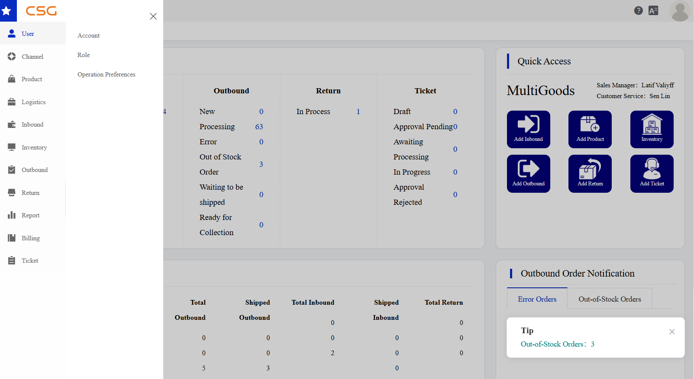
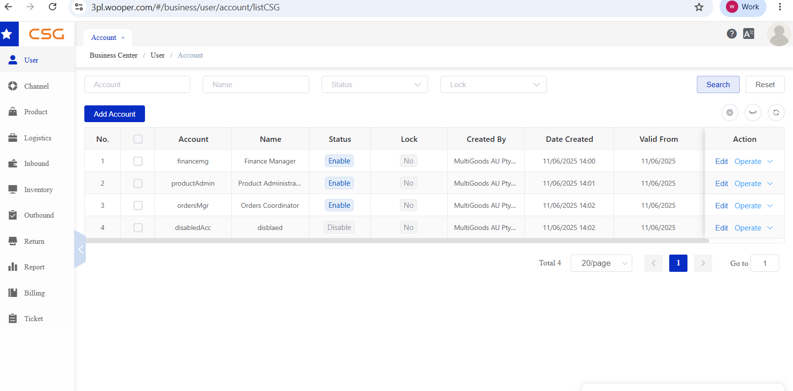
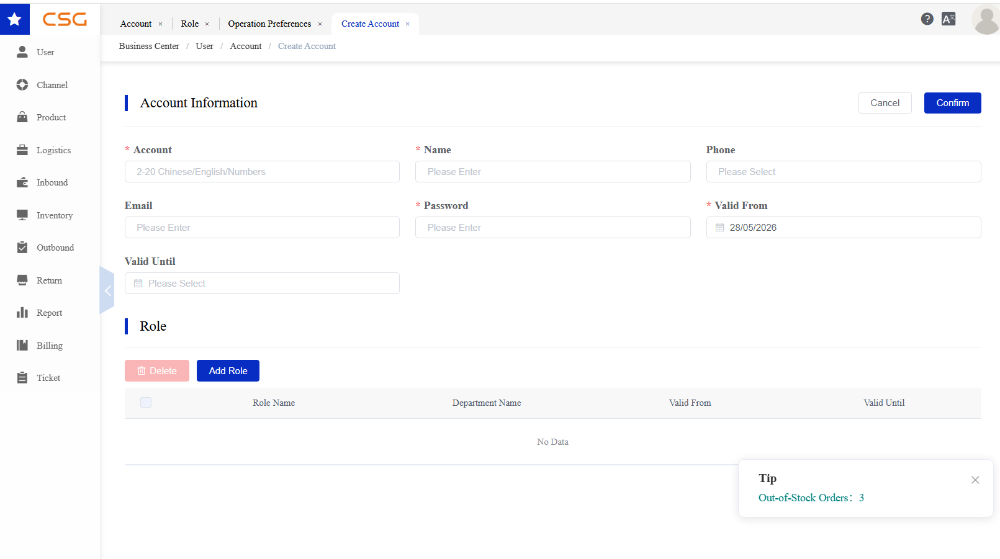
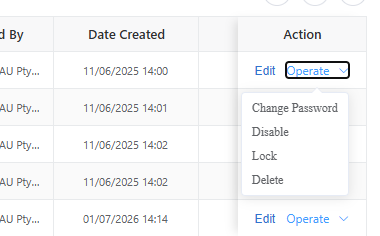
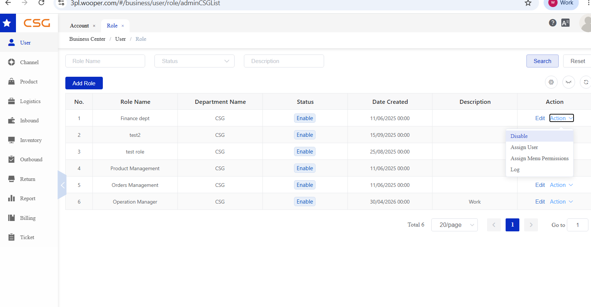
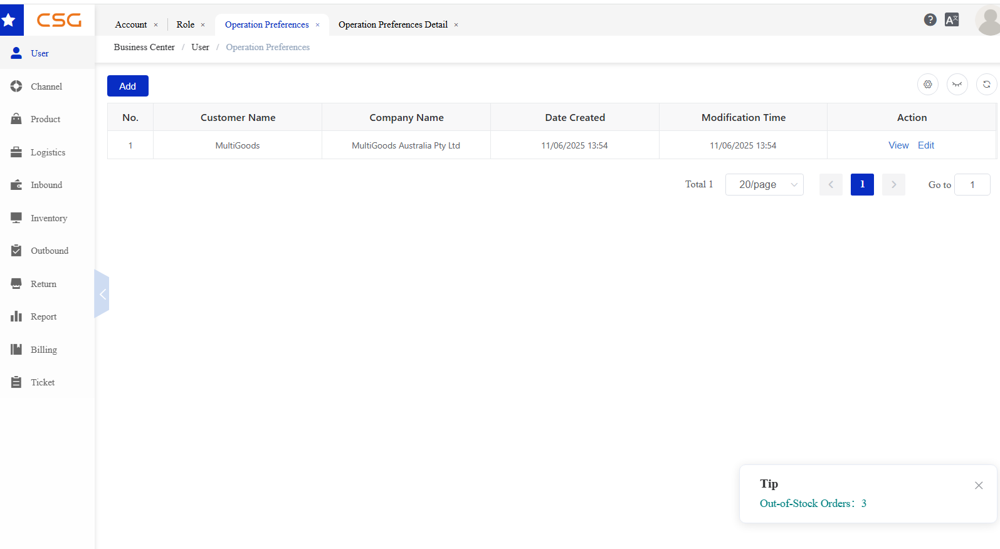
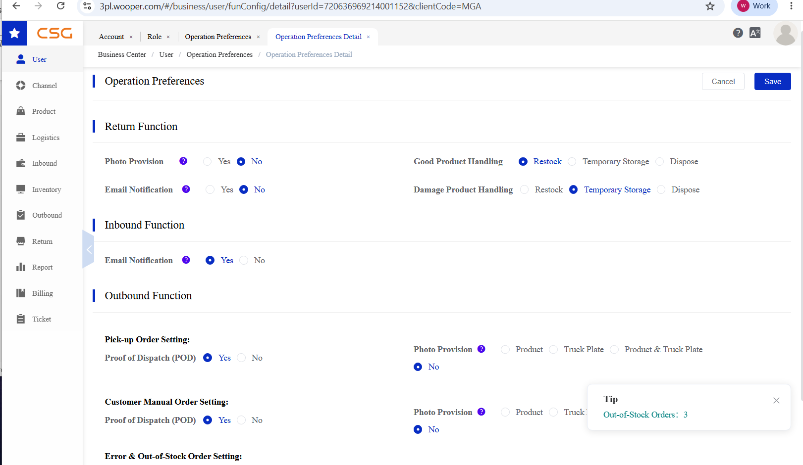

# 5. User Management

User Management controls who can use the Customer Portal and what each user can access. Only an administrator can create and maintain accounts for users within the customer’s company. Separate accounts may be provided to finance, cashiering, supplier-management, and other operational staff, with access determined by their assigned roles. Operation Preferences controls selected operational behaviours, including notification and photographic-record options.

The User Management module provides tools for managing user accounts, access permissions, and customer-specific operational settings.

The module consists of three sections:

User Account – Create and manage user accounts within the company, including role assignment and account status.

Role – Define user roles and configure menu permissions.

Operation Preferences – Configure operational rules and preferences for warehouse processes.

**Note:** Before creating a user account, at least one role must exist in the system. User accounts cannot be created without assigning a role.

## 5.1 User Account

### 5.1.1 Overview

The User Account module is used to create and manage user login accounts within the CSG Customer Portal. Administrators can create new accounts, maintain user information, assign roles, and control user access to the system.

Unlike the Account Center, which is used to manage the currently logged-in user's personal information, the User Account module is designed for administrators to manage all user accounts within the company.

Users can:

Create new user accounts

View existing accounts

Edit user information

Assign or remove roles

Enable or disable accounts

Lock or unlock accounts

Reset user passwords

Delete user accounts

*Figure 1. Overview screen from the CSG ERP User Manual.*

### 5.1.2 Account List

The Account List displays all users created under the customer company.

Navigation

Main Functions

| Function | Description |
| --- | --- |
| Search | Search user accounts. |
| Add Account | Create a new user account. |
| Edit | Modify account information. |
| Operate | Perform account management actions. |

Account Information

| Column | Description |
| --- | --- |
| Account | Login account. |
| Name | Username. |
| Status | Account status (Enable / Disable). |
| Lock | Account lock status. |
| Created By | User who created the account. |
| Date Created | Account creation date. |
| Valid From | Account effective date. |
| Action | Edit or manage the account. |

*Figure 2. Account List screen from the CSG ERP User Manual.*

### 5.1.3 Add/Edit New User

The Add/Edit Account page is used to maintain user information and assign roles to a user account. The administrator sets the login account. The system generates the initial password, which the administrator can subsequently change or reset.

Account Information

| Field | Description |
| --- | --- |
| Account | Unique login account used to access the system. |
| Name | User's display name. |
| Phone | Contact phone number. |
| Email | User's email address (optional). |
| Valid From | Date the account becomes active. |
| Valid Until | Account expiration date (optional). |

*Figure 3. Add/Edit New User screen from the CSG ERP User Manual.*

Role Assignment

One or more predefined roles can be assigned to the user account. Each role must first be created separately, and its permissions can be configured independently.

Roles may be assigned individually or combined for the same user. The assigned roles determine which permitted menus and functions the user can access after logging in.

**Steps**

Step 1: Open User → Account.

Step 2: Click Add Account or Edit.

Step 3: Enter the user's account information.

Step 4: Click Add Role and select one or more roles.

Step 5: Click Confirm to save.

### 5.1.4 Account Operations

The Operate menu provides additional account management functions.

*Figure 4. Account Operations screen from the CSG ERP User Manual.*

| Operation | Description |
| --- | --- |
| Change Password | Reset or update the user's login password. |
| Disable | Disable the account and prevent login. |
| Enable | Re-enable a disabled account. |
| Lock | Lock the account to prevent access. |
| Unlock | Unlock the account. |
| Delete | Permanently remove the account. A deleted account cannot be restored. |

## 5.2 Role

### 5.2.1 Overview

The Role section allows authorized users to create and manage roles for their own company users.

Roles are defined by the customer company and can be used to control what each user can access in the portal. Permissions are configured independently for each role, and separately created roles can be combined when assigning access to a user.

*Figure 5. Overview screen from the CSG ERP User Manual.*

### 5.2.2 Role List

Navigation

The Role page displays all roles created by the customer company.

Users can:

Search roles by role name, status or description

Add new roles

Edit existing roles

Disable roles

Assign users to roles

Assign menu permissions

View operation logs

### 5.2.3 Role Actions

| Action | Description |
| --- | --- |
| Disable | Disable the selected role |
| Assign User | Assign company users to the role |
| Assign Menu Permissions | Set portal access permissions for the role |
| Log | View role operation records |

## 5.3 Operation Preferences

### 5.3.1 Overview

The Operation Preferences section allows authorized users to view and configure operational settings for the customer account.

These settings control how certain inbound, outbound and return processes are handled in the portal.

**Note:** Users can view the current operation preference settings by clicking View. To modify the settings, users must click Edit. Changes cannot be made in View mode.

### 5.3.2 Operation Preferences List

*Figure 6. Operation Preferences List screen from the CSG ERP User Manual.*

Navigation

The list page displays the operation preference record for the customer company.

The page includes:

| Column | Description |
| --- | --- |
| Customer Name | Customer account name |
| Company Name | Registered company name |
| Date Created | Time when the preference record was created |
| Modification Time | Last updated time |
| Action | View or edit operation preferences |

### 5.3.3 Operation Preferences Detail

Users can click View or Edit to open the operation preferences detail page.

The settings may include:

Return function settings

Inbound email notification

Outbound POD settings

Photo provision requirements

Product handling rules

Users can update the settings and click Save to apply the changes.

Email notification is provided without an additional service fee. Options that require photographic records or photo retention are chargeable services. Where a charge applies, the portal displays the applicable fee so that an authorized user can review it before enabling the option.

*Figure 7. Operation Preferences Detail screen from the CSG ERP User Manual.*

## Source

CSG ERP User Manual, section 5, "User Management".
