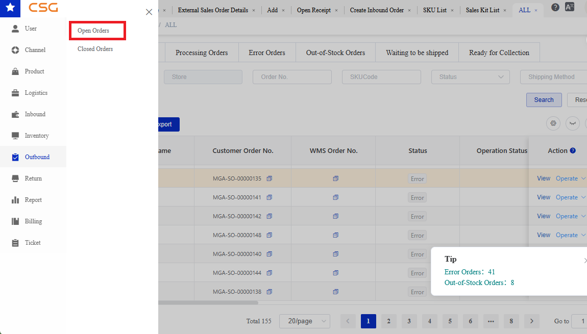
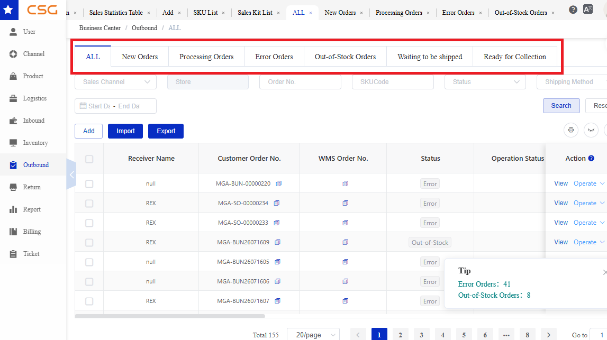
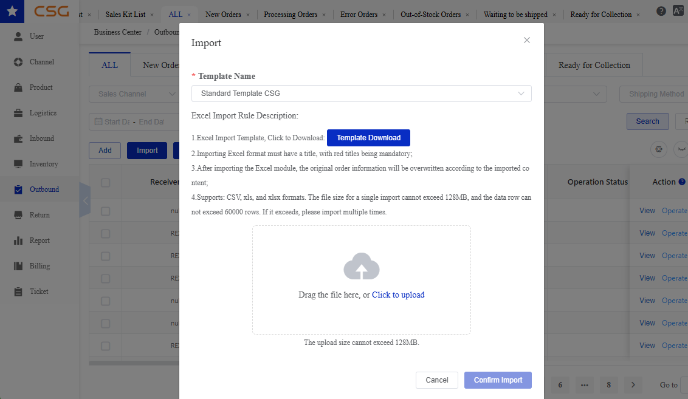
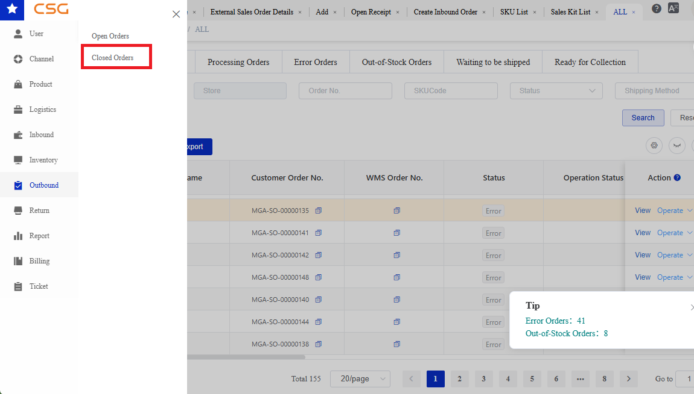
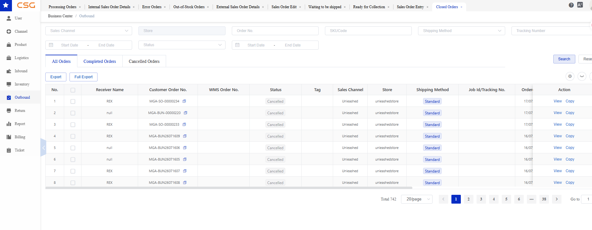
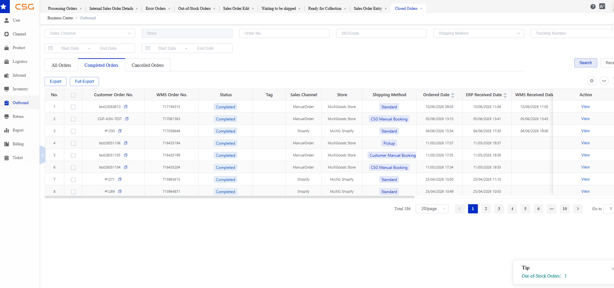
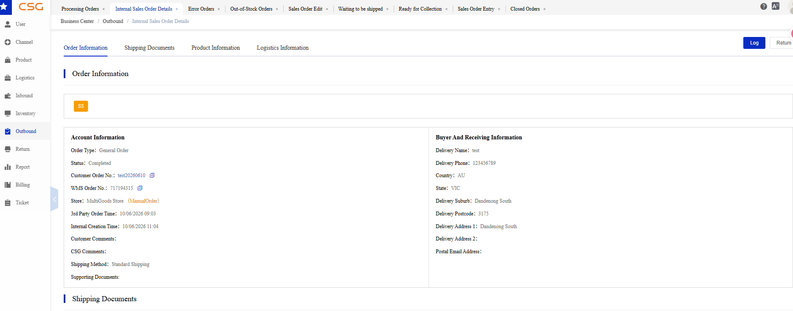
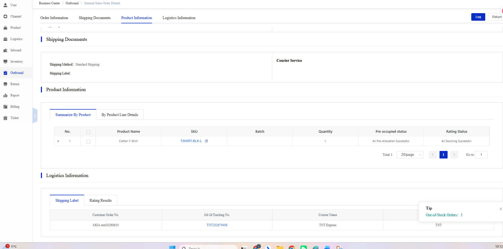
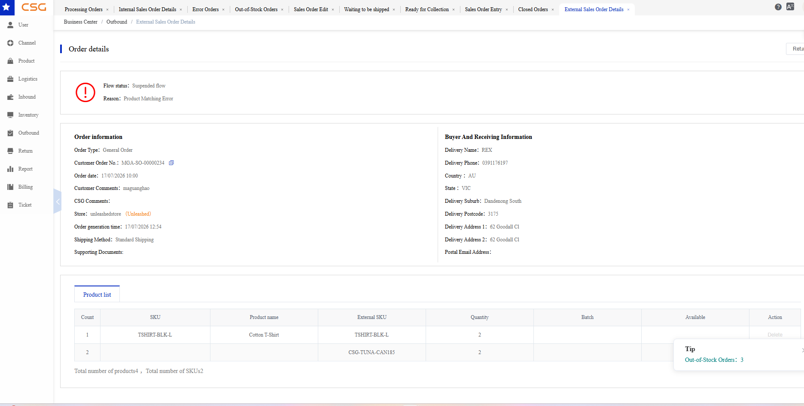
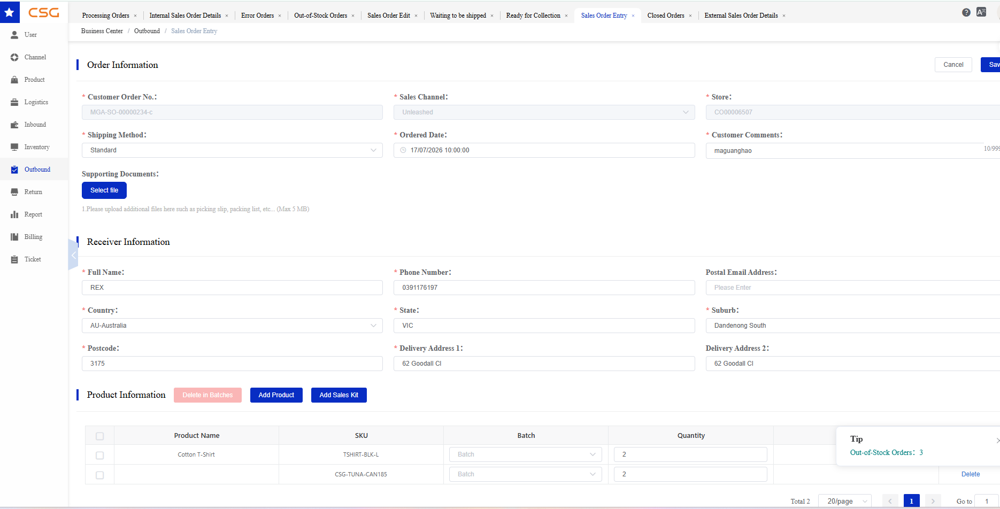

# 11. Outbound

The Outbound module is used to create, review, and monitor orders that instruct the warehouse to pick, pack, and dispatch goods.

## 11.1 Overview

The Outbound Orders module is used to manage customer orders from order creation or synchronization through warehouse processing, shipment, or customer collection.

Outbound orders may be:

Synchronized from connected sales channels, such as Shopify, Shopify GraphQL, WooCommerce, or Unleashed.

Created manually in the CSG Customer Portal.

Imported in bulk using the system import function.

The Outbound Orders module includes:

Open Orders – Displays orders that are still awaiting processing, currently being processed, or require user attention.

Closed Orders – Displays orders whose outbound processing has ended, such as completed, shipped, collected, or cancelled orders, depending on the order status.

Open Orders and Closed Orders

| Section | Description |
| --- | --- |
| Open Orders | Orders that have not completed the outbound fulfillment process. Depending on their status, users may view, edit, cancel, reprocess, or perform other operations. |
| Closed Orders | Orders whose processing has ended. Closed orders are generally retained for shipment tracking, historical reference, and audit purposes. |

Relationship with Other Modules

Product provides the SKU and Sales Kit information used in outbound orders.

Channel synchronizes customer orders from external sales platforms.

Inventory provides available stock for order allocation.

Logistics provides the courier and shipping services used for delivery.

Sales Kits are expanded into their component SKUs during fulfillment.

## 11.2 Open Orders

### 11.2.1 Overview

*Figure 1. Overview screen from the CSG ERP User Manual.*

Navigation

The Open Orders page displays outbound orders that have not yet completed the fulfillment process.

It includes newly created orders, orders being processed by the warehouse, orders with errors, orders with insufficient inventory, and orders awaiting shipment or collection.

Users can:

View all active outbound orders.

Search orders using multiple filter conditions.

Create manual outbound orders.

Import orders in bulk.

Export order information.

View order details.

Perform operations based on the current order status.

Review and resolve error or out-of-stock orders.

**Note:** The actions available for an order depend on its current status and the permissions assigned to the user.

### 11.2.2 Open Order Categories

*Figure 2. Open Order Categories screen from the CSG ERP User Manual.*

The Open Orders page contains the following tabs.

| Tab | Description |
| --- | --- |
| All | Displays all open outbound orders, regardless of their current status. |
| New Orders | Displays newly created or synchronized orders that have not yet entered warehouse processing. |
| Processing Orders | Displays orders that have been accepted by the WMS and are currently being processed by the warehouse. |
| Error Orders | Displays orders that cannot proceed because of data validation, product matching, address, or integration errors. |
| Out-of-Stock Orders | Displays orders that cannot proceed because there is insufficient available inventory. |
| Waiting to be Shipped | Displays orders for which warehouse preparation has been completed and that are waiting for dispatch. |
| Ready for Collection | Displays pickup orders that are ready for collection by the customer or nominated carrier. |

### 11.2.3 All Orders

Overview

The All tab displays every order currently included in Open Orders.

This page allows users to review orders across all open statuses without switching between individual tabs.

Available Functions

| Function | Description |
| --- | --- |
| Search | Search orders using the selected filter conditions. |
| Reset | Clear all search conditions. |
| Add | Manually create a new outbound order. |
| Import | Import outbound orders in bulk. |
| Export | Export order information based on the current search results. |
| View | Open the order details page. |
| Operate | Perform status-specific operations on the selected order. |
| Refresh | Refresh the page and retrieve the latest order information. |

Order List Information

The columns displayed may vary depending on the selected order tab.

| Field | Description |
| --- | --- |
| Receiver Name | Name of the order recipient. |
| Customer Order No. | Customer’s order reference number. |
| WMS Order No. | Order number generated by the Warehouse Management System. |
| Sales Channel | Platform or system from which the order originated. |
| Store | Store associated with the order. |
| Status | Current overall order status. |
| Operation Status | Current warehouse operation stage. |
| Label | Order or shipping label type, where applicable. |
| Shipping Method | Selected delivery or pickup method. |
| Ordered Date | Date and time the order was created. |
| ERP Received Date | Date and time the order was received by the CSG system. |
| Action | Available actions, such as View or Operate. |

### 11.2.4 Search Open Orders

Users can search outbound orders using one or more filter conditions.

Search Criteria

| Field | Description |
| --- | --- |
| Sales Channel | Filter orders by source platform or system. |
| Store | Filter orders by connected store. |
| Order No. | Search by customer order number or related order number. |
| SKU Code | Search for orders containing a specific SKU. |
| Status | Filter by order status. |
| Shipping Method | Filter by delivery or collection method. |
| Date Range | Search for orders within a specified date range. |

**Steps**

Select the required order tab.

Enter one or more search conditions.

Click Search.

Review the matching orders.

**Notes**

Multiple search criteria can be combined.

Click Reset to clear all search conditions.

Search fields may vary slightly between individual order tabs.

### 11.2.5 New Orders

Overview

The New Orders tab displays newly created, imported, or synchronized orders that have not yet entered warehouse processing.

Orders remain in this tab while the system validates information such as:

Customer and delivery details

Product and SKU matching

Inventory availability

Warehouse assignment

Shipping configuration

Typical Next Stage

If validation succeeds, the order moves to Processing Orders.

If validation fails:

Data problems may move the order to Error Orders.

Insufficient inventory may move the order to Out-of-Stock Orders.

### 11.2.6 Processing Orders

Overview

The Processing Orders tab displays orders that have been accepted by the WMS and are currently being handled by the warehouse.

Typical warehouse activities include:

Inventory allocation

Picking

Packing

Label preparation

Shipment or collection preparation

Processing Order Information

| Field | Description |
| --- | --- |
| Customer Order No. | Customer order reference. |
| WMS Order No. | WMS processing order number. |
| Sales Channel | Source platform or system. |
| Store | Store associated with the order. |
| Status | Current order status. |
| Operation Status | Current warehouse processing stage. |
| Label | Assigned order or shipping label. |
| Shipping Method | Selected delivery method. |
| Ordered Date | Date the order was created. |
| Action | View or operate the order. |

**Note:** Once an order enters Processing, editing and cancellation are available only during the initial processing window. After the order has remained in Processing for approximately one hour, these actions may no longer be available. Always use the actions currently shown in the portal to determine whether the order can still be changed or cancelled.

### 11.2.7 Error Orders

Overview

The Error Orders tab displays orders that cannot proceed because of validation, product, address, or integration errors.

Common Error Types

| Error Type | Description |
| --- | --- |
| Delivery Address Anomaly | The receiver address contains missing, invalid, or inconsistent information. |
| Product Matching Error | A product or SKU from the source order cannot be matched to a product in the CSG Product module. |

Other errors may appear depending on the order source and system configuration.

Available Functions

| Function | Description |
| --- | --- |
| View | View the order and error details. |
| Operate | Perform an available corrective or cancellation action. |
| BulkCancel | Cancel multiple selected error orders. |

Handling an Error Order

Open the order using View.

Review the Error Type and Error Details.

Correct the source data or related system configuration.

Use the available Operate or reprocessing function, where applicable.

Confirm that the order proceeds to the next status.

**Notes**

For a Product Matching Error, verify that the source SKU exactly matches a SKU or Sales Kit configured in the Product module.

For a Delivery Address Anomaly, verify the country, state, suburb, postcode, and street address.

Cancelling an order stops further warehouse processing.

### 11.2.8 Out-of-Stock Orders

Overview

The Out-of-Stock Orders tab displays orders that cannot proceed because there is insufficient available inventory for one or more products.

This can affect:

Individual SKUs

Batch-controlled products

Component SKUs included in a Sales Kit

Available Functions

| Function | Description |
| --- | --- |
| Export | Export the selected out-of-stock order information. |
| Export SKU | Export SKU information associated with out-of-stock orders. |
| Bulk Cancel | Cancel multiple selected orders. |
| Reprocess Order | Recheck inventory and attempt to process the order again. |
| View | View the order details. |
| Operate | Perform available order operations. |

**Notes**

Ensure sufficient available inventory exists before reprocessing.

Completing an inbound receipt may replenish inventory for the affected SKU.

A Sales Kit remains out of stock if any required component SKU has insufficient inventory.

Reprocessing does not create inventory; it only checks inventory again.

### 11.2.9 Waiting to be Shipped

Overview

The Waiting to be Shipped tab displays delivery orders that have completed the required warehouse preparation and are waiting for shipment or dispatch confirmation.

Typical completed activities include:

Inventory allocation

Picking

Packing

Shipping label preparation

Once shipment is confirmed, the order is moved to Closed Orders.

**Note:** Waiting to be Shipped is generally used for courier or freight delivery orders rather than customer pickup orders.

### 11.2.10 Ready for Collection

Overview

The Ready for Collection tab displays pickup orders that have been prepared and are ready for collection by the customer, nominated person, or carrier.

These orders generally use a pickup shipping method rather than a standard courier delivery service.

Once collection is confirmed, the order is moved to Closed Orders.

**Notes**

Verify the collector’s details before releasing the order.

Follow the configured Proof of Dispatch or photo requirements if enabled in Operation Preferences.

Ready for Collection orders should not be processed as standard courier shipments.

### 11.2.11 Add Order

#### 11.2.11.1 Overview

The Add Order function allows users to manually create an outbound order in the CSG Customer Portal.

Before creating an outbound order, at least one Sales Channel must be available in Channel Management, because the Sales Channel is a required field when creating the order.

A manually created outbound order is not restricted to the Manual Order channel. Users may select any available Sales Channel and associated Store according to how the customer wants the order to be classified, managed, and reported.

Navigation

**Important:** If no Sales Channel is available, configure the required channel or store under Channel → Store before creating the outbound order.

**Note:** The selected Sales Channel is used to classify the order. It does not necessarily indicate whether the order was originally created internally or synchronized from an external platform.

#### 11.2.11.2 Order Information

The Order Information section records the source, shipping arrangement, and general instructions for the outbound order.

Before creating a manual outbound order, at least one Sales Channel and Store must already exist in Channel Management.

A manually created order is not limited to the Manual Order channel. Users may select any available Sales Channel and Store according to how the order should be classified and reported.

General Order Information

| Field | Required | Description |
| --- | --- | --- |
| Customer Order No. | Must | Enter a unique customer order reference used to identify the order in the Customer Portal and WMS. |
| Sales Channel | Must | Select an existing Sales Channel for order classification. The selection is not limited to ManualOrder. |
| Store | Must | Select the Store associated with the selected Sales Channel. |
| Shipping Method | Must | Select how the order will be delivered or collected. The selected method determines the logistics booking process and displays the corresponding additional fields. |
| Ordered Date | Must | Date and time when the order was created. The system may automatically populate the current date and time. |
| Customer Comments | Optional | Enter packing instructions, delivery requirements, collection details, or other special-handling information. |
| Supporting Documents | Optional | Upload documents such as packing lists, picking instructions, booking documents, or other supporting files. The maximum file size is 5 MB. |

**Notes**

The Customer Order No. should be unique to prevent duplicate orders.

A Sales Channel and Store must exist before the order can be created.

The Sales Channel is used to classify the order and does not necessarily indicate whether the order was created internally or received from an external platform.

Select the Shipping Method carefully because it determines who arranges the courier, which additional fields are required, and whether the order is delivered or collected.

The fields displayed in the Order Information and Receiver Information sections may change according to the selected Shipping Method.

Shipping Method

The Shipping Method determines how the order will be fulfilled and who is responsible for arranging the courier, freight booking, or collection.

The system supports the following methods:

| Shipping Method | Description |
| --- | --- |
| Standard | Uses a normal delivery service for routine, non-urgent orders. |
| Express | Uses an expedited or priority delivery service for urgent orders. |
| CSG Manual Booking | CSG manually reviews the shipment and arranges the courier or freight booking. This method is normally used for large, complex, or special-handling orders. |
| Customer Manual Booking | The customer arranges the courier or freight booking and provides the required booking details and shipping documents. |
| Pickup | The order is prepared by the warehouse and collected later by the customer or a nominated carrier. |

- Standard
Select Standard for normal delivery orders that do not require expedited or special freight arrangements.

The order will use the standard logistics workflow and the courier services available for the selected Store.

No additional manual-booking fields are displayed for this method.

**Note:** Courier availability may depend on the Store’s Logistics Distribution configuration, destination postcode, shipment dimensions, and service availability.

- Express
Select Express when the order requires a faster or priority delivery service.

No additional manual-booking fields are displayed for this method.

**Note:** Express delivery may have shorter delivery times and higher freight charges than Standard delivery. Availability depends on the destination and configured courier services.

- CSG Manual Booking
Select CSG Manual Booking when the order requires manual review and intervention by the CSG Operations Team.

This method is generally used when:

The order is large or operationally complex.

Special freight or handling arrangements are required.

Automatic logistics allocation is not suitable.

CSG must contact and book a courier or freight provider manually.

A freight quotation or customer confirmation may be required.

Supporting documents or special instructions need to be reviewed.

Orders using CSG Manual Booking should be manually created so that the required shipment details can be reviewed before booking.

Additional Fields

| Field | Required | Description |
| --- | --- | --- |
| Confirm Quote | Conditional | Determines whether the customer must approve the freight quotation before CSG confirms the booking. |
| Dedicated Courier | Optional | Enable this option when a specific courier service must be used for the shipment. |
| Courier Service | Conditional | Select the required courier service. This field is required when a dedicated courier must be assigned. |
| Supporting Documents | Optional | Upload freight instructions, shipment requirements, packing documents, or other information required for manual review. |

Confirm Quote

The Confirm Quote setting determines whether customer approval is required before CSG confirms the courier or freight booking.

| Setting | Description |
| --- | --- |
| On | CSG obtains a freight quotation and sends it to the customer for approval. The booking will not be confirmed until the customer approves the quotation. |
| Off | Separate customer approval is not required. CSG may proceed with the booking according to the agreed logistics arrangement. |

#### 11.2.11.3 Receiver Information

Enter the delivery information for the order recipient.

| Field | Required | Description |
| --- | --- | --- |
| Full Name | Must | Full name of the recipient. |
| Phone Number | Must | Contact number for delivery communication. |
| Postal Email Address | Optional | Email address used for shipment or delivery notifications. |
| Country | Must | Destination country. |
| State | Must | Destination state or province. |
| Suburb | Must | Destination suburb or city. |
| Postcode | Must | Postal or ZIP code used for delivery routing. |
| Delivery Address 1 | Must | Primary delivery address. |
| Delivery Address 2 | Optional | Additional address information, such as unit, apartment, building, or floor number. |

**Important:** Check all receiver and address information carefully. An incorrect postcode, state, suburb, phone number, or delivery address may cause logistics allocation errors, delivery delays, or order cancellation.

#### 11.2.11.4 Product Information

The Product Information section is used to add the products included in the outbound order.

Product Fields

| Field | Description |
| --- | --- |
| Product Name | Name of the selected product or Sales Kit. |
| SKU | Unique product or Sales Kit identifier. |
| Batch | Batch selected for a batch-controlled product, where applicable. |
| Quantity | Quantity ordered. |
| Available | Current available inventory for the selected SKU. |
| Action | Remove the selected line from the current order. |

Available Functions

| Function | Description |
| --- | --- |
| Add Product | Add one or more individual products from the SKU List. |
| Add Sales Kit | Add a predefined Sales Kit from the Sales Kit List. |
| Delete in Batches | Remove multiple selected product lines from the current order. |

**Notes**

Individual products must already exist in .

Sales Kits must already exist in .

Review the Available quantity before saving the order.

Products with insufficient inventory may cause the order to enter Out-of-Stock Orders.

Removing a product line from the order does not delete the SKU from the Product module.

#### 11.2.11.5 Add Product

The Add Product function allows users to select individual physical products from the existing SKU List.

**Steps**

Click Add Product.

Search by Product Name or SKU if required.

Select one or more products.

Click Confirm.

Enter the required quantity.

Review the available inventory.

**Notes**

Multiple products can be selected at the same time.

Only enabled SKUs can normally be used for new orders.

The SKU must already exist in the Product module.

#### 11.2.11.6 Add Sales Kit

The Add Sales Kit function allows users to add a predefined product bundle to the outbound order.

A Sales Kit is sold as one product but consists of multiple component SKUs.

During warehouse fulfillment, the system allocates and deducts inventory from the component SKUs rather than from the Sales Kit itself.

**Steps**

Click Add Sales Kit.

Search for the required Sales Kit.

Select the Sales Kit.

Click Confirm.

Enter the required Sales Kit quantity.

Review component inventory availability.

**Notes**

A Sales Kit does not normally maintain independent inventory.

Inventory availability is determined by the stock of its component SKUs.

If any required component SKU has insufficient inventory, the order may enter Out-of-Stock Orders.

Sales Kits are available in Outbound because the warehouse may need to pick and pack multiple component SKUs as one customer bundle.

#### 11.2.11.7 Save Order

After completing the order:

Review the Order Information.

Verify the Receiver Information.

Confirm all products, Sales Kits, and quantities.

Review available inventory.

Click Save.

The order will be created and displayed in New Orders for validation and warehouse processing.

### 11.2.12 Import Orders

The Import function allows users to create multiple outbound orders in bulk.

*Figure 3. Import Orders screen from the CSG ERP User Manual.*

**Steps**

Navigate to Outbound → Outbound Order.

Click Import.

Prepare the import file according to the required system format.

Select and upload the completed file.

Review the import results.

Correct any rejected or invalid records if required.

**Notes**

SKUs in the import file must already exist in the Product module.

Customer order numbers should be unique.

Missing receiver information, invalid addresses, unmatched SKUs, or incorrect data may cause orders to be rejected or moved to Error Orders, depending on system rules.

Review imported orders before warehouse processing begins.

### 11.2.13 Export Orders

The Export function allows users to download order records for reporting, review, or reconciliation.

**Steps**

Apply the required search filters.

Click Search.

Click Export.

Download the generated file.

**Note:** The exported data normally reflects the current search conditions and selected order tab.

## 11.3 Closed Orders

### 11.3.1 Overview

*Figure 4. Overview screen from the CSG ERP User Manual.*

The Closed Orders module contains outbound orders that have reached the end of their lifecycle.

Orders in this module are no longer processed by the warehouse and are retained for historical reference, reporting, and auditing.

The module is divided into three categories:

All Orders – Displays all closed orders.

Completed Orders – Displays successfully fulfilled orders.

Cancelled Orders – Displays cancelled orders.

### 11.3.2 All Orders

*Figure 5. All Orders screen from the CSG ERP User Manual.*

The All Orders tab displays every closed outbound order, including both completed and cancelled orders.

Users can search historical records, review order details, and perform actions that are available based on the order status.

Available Functions

| Function | Description |
| --- | --- |
| View | Display the complete order details. |
| Copy | Available only for cancelled orders. Creates a new outbound order using the selected cancelled order as a template. |
| Export | Export the current search results. |
| Full Export | Export all closed order records. |

### 11.3.3 Completed Orders

*Figure 6. Completed Orders screen from the CSG ERP User Manual.*

The Completed Orders tab displays orders that have been successfully fulfilled.

Completed orders are read-only records and cannot be modified or copied.

Available Functions

| Function | Description |
| --- | --- |
| View | Display the complete information for the selected completed order. |

View Order

*Figure 7. Completed Orders screen from the CSG ERP User Manual.*

*Figure 8. Completed Orders screen from the CSG ERP User Manual.*

Click View to display the complete information for the selected completed order.

The order details page contains the following sections:

| Section | Description |
| --- | --- |
| Order Information | Displays the order type, status, customer order number, WMS order number, store, order creation times, comments, shipping method, and receiver information. |
| Shipping Documents | Displays shipping method, shipping label, courier service information, quotation details, and shipping-related documents. |
| Product Information | Displays all products included in the order, including SKU, batch, quantity, pre-allocation status, and rating status. Users can switch between Summarize by Product and By Product Line Details. |
| Logistics Information | Displays shipping labels, courier information, tracking number (Job ID/Tracking No.), courier service, and rating results generated during shipment. |
| Log | Displays the complete operation history of the order for auditing and tracking purposes. |

**Notes**

Completed orders are read-only and cannot be edited.

All information displayed reflects the final completed order.

Shipping labels and tracking information are available if they were generated during fulfillment.

The Log button provides a complete history of actions performed on the order.

### 11.3.4 Cancelled Orders

The Cancelled Orders tab displays orders that were cancelled before completion.

Users can review the cancelled order or create a new order by using the Copy function.

Available Functions

| Function | Description |
| --- | --- |
| View | Display the complete information for the selected cancelled order. |
| Copy | Open the Sales Order Entry page and create a new outbound order using the cancelled order information as a template. |

**Notes**

The original cancelled order remains unchanged.

The copied order is treated as a new outbound order and follows the standard outbound workflow after it is saved.

Users can modify the copied order information before saving.

View Order

*Figure 9. Cancelled Orders screen from the CSG ERP User Manual.*

Click View to display the complete information for the selected cancelled order.

The order details page displays:

| Section | Description |
| --- | --- |
| Flow Status | Displays the reason why the order was cancelled or could not continue processing, if applicable. |
| Order Information | Displays the original order information, including customer order number, order date, store, shipping method, customer comments, and receiver details. |
| Product List | Displays all products contained in the cancelled order, including SKU, external SKU, quantity, and available inventory information. |

**Notes**

Cancelled orders are read-only and cannot be modified.

The displayed information reflects the original order before cancellation.

Copy Order

*Figure 10. Cancelled Orders screen from the CSG ERP User Manual.*

Click Copy to create a new order using the cancelled order as a template.

The system opens the Sales Order Entry page and automatically copies the original order information, including:

Order Information

Receiver Information

Product Information

Shipping Method

Customer Comments

Users can modify the copied information, add or remove products, update quantities, and then click Save to create a new order.

**Notes**

A new customer order number is generated for the copied order.

The copied order is treated as a new order and follows the normal outbound order processing workflow.

Changes made to the copied order do not affect the original cancelled order.

## Source

CSG ERP User Manual, section 11, "Outbound".
